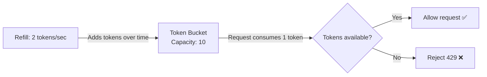
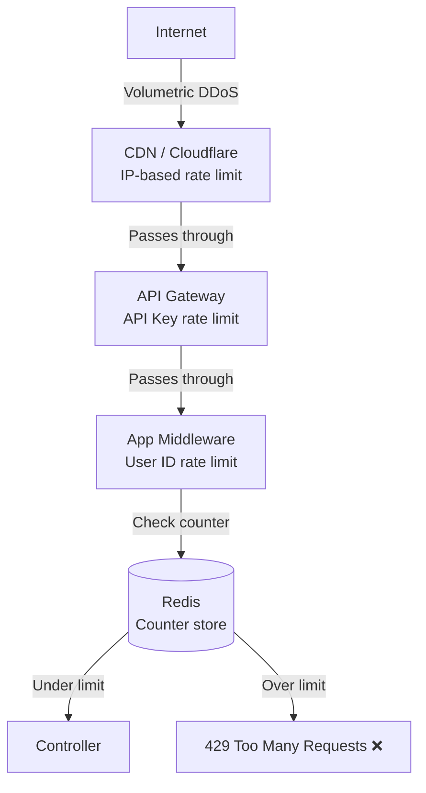

# Rate Limiting

> **Definition:** Controlling how many requests a client can make to a service within a given time window.

---

## Table of Contents

- [Why Rate Limiting?](#why-rate-limiting)
- [Algorithms](#algorithms)
- [Identifying the Client](#identifying-the-client)
- [Where to Enforce Rate Limiting](#where-to-enforce-rate-limiting)
- [Implementation in .NET / C#](#implementation-in-net--c)
- [Key Takeaways](#key-takeaways)

---

## Why Rate Limiting?

- Protect against **DDoS attacks** — one client flooding your server with millions of requests
- Prevent **abuse** — a client hammering your API unintentionally (runaway loop)
- Ensure **fair usage** — one heavy client shouldn't degrade experience for others
- Protect **resource exhaustion** — DB, CPU, and memory all have limits

```
Rule: max 100 requests per minute per user

User A → 100 requests in 1 minute → all pass ✅
User A → 101st request           → rejected 429 Too Many Requests ❌

User B → 50 requests in 1 minute → all pass ✅ (not affected by User A)
```

---

## Algorithms

### Token Bucket — The Most Widely Used

The dominant algorithm in production — used by **AWS API Gateway, Stripe, and Nginx**.

**How it works:**
- A bucket holds up to `N` tokens
- Tokens refill at a fixed rate
- Each request consumes one token
- If the bucket is empty → request is rejected

```
Bucket capacity: 10 tokens
Refill rate: 2 tokens per second

Client makes 5 requests instantly:
  → 5 tokens consumed → 5 remaining ✅

Client makes 6 more requests instantly:
  → 5 consumed → bucket empty → 1 rejected ❌

1 second passes:
  → 2 tokens refilled → client can make 2 more requests ✅
```



> 💡 **Bucket capacity** controls burst size — how many requests can fire at once. **Refill rate** controls sustained throughput — how many requests per second over time.

---

### Other Algorithms — Brief Overview

| Algorithm | How it works | Strength | Weakness |
|---|---|---|---|
| **Fixed Window Counter** | Count requests per fixed time bucket (e.g. every 60s) | Simple, memory efficient | Boundary burst problem |
| **Sliding Window Log** | Store timestamp of every request, count within rolling window | Very accurate | High memory usage |
| **Sliding Window Counter** | Blend of fixed window + sliding approximation | Memory efficient + accurate | Slight approximation |
| **Leaky Bucket** | Requests processed at fixed rate — excess queued or dropped | Very smooth output | No bursting — feels rigid |

### The Fixed Window Boundary Burst Problem

The main weakness of Fixed Window — a client can send **2× the limit** by straddling two windows:

```
Window 1                          Window 2
|_________________🔥🔥🔥|🔥🔥🔥___________________|
0s               50s  60s  70s                    120s

🔥 = 100 requests at second 50 → allowed ✅ (Window 1, counter = 100)
🔥 = 100 requests at second 70 → allowed ✅ (Window 2 reset, counter = 100)

Result: 200 requests in only 20 seconds — double the intended limit ❌
```

> ⚠️ The window resets at exactly 60s as expected — the trick is the client timed requests to straddle the boundary. 100 at the tail of Window 1, 100 at the head of Window 2. The server saw 100 in each window and allowed both.

---

## Identifying the Client

Every incoming request needs a **unique identifier** to track its counter.

| Identifier | When to use | Limitation |
|---|---|---|
| **IP Address** | Unauthenticated endpoints (login, signup) | Easy to spoof, shared NAT blocks legit users |
| **User ID** | Authenticated endpoints | Requires auth — not available on public endpoints |
| **API Key** | Third party clients | One key per client application |
| **IP + User ID** | Extra sensitive endpoints | Attacker can bypass using multiple devices |

### Why IP + User ID is not always the answer

```
Attacker has User ID: 123
Attacks from:
  Device 1 → IP: 1.1.1.1 → key: "rate:user:123:1.1.1.1" → 100 requests ✅
  Device 2 → IP: 2.2.2.2 → key: "rate:user:123:2.2.2.2" → 100 requests ✅
  Device 3 → IP: 3.3.3.3 → key: "rate:user:123:3.3.3.3" → 100 requests ✅

Total: 300 requests — 3x the limit ❌
```

Each device gets its own counter because the key includes the IP.

**Solution — rate limit by User ID only for authenticated endpoints:**

```
Device 1 → IP: 1.1.1.1 → key: "rate:user:123" → 50 requests
Device 2 → IP: 2.2.2.2 → key: "rate:user:123" → 50 requests
Device 3 → IP: 3.3.3.3 → key: "rate:user:123" → 50 requests

Total counter on "rate:user:123" = 150 → REJECT ❌
```

All devices share the same counter — doesn't matter how many devices they use.

> 💡 For authenticated requests always rate limit by **User ID alone** — it doesn't matter how many devices or IPs the attacker uses, they all share one counter tied to their identity.

---

## Where to Enforce Rate Limiting

There are 4 layers where rate limiting can be enforced — each serves a different purpose.



### Layer 1 — CDN / Edge (Cloudflare, AWS CloudFront)

Requests are blocked **before they enter your infrastructure**.

- ✅ Stops DDoS at the edge — your servers never see the traffic
- ✅ No infrastructure cost on your end — CDN absorbs it
- ✅ Global — works across all regions automatically
- ❌ Coarse grained — limited to IP-based rules, no user ID awareness
- ❌ Limited control over the logic

> 💡 Best for: **volumetric DDoS protection** — blocking raw floods of traffic before they reach you.

### Layer 2 — API Gateway (Nginx, Traefik, Ocelot)

Sits at the **entry point of your system** — before any service processes the request.

- ✅ Centralised — one place handles all services
- ✅ Can rate limit by IP, API key, or header values
- ✅ No code changes needed in individual services
- ❌ Limited access to business logic — can't rate limit by user ID easily
- ❌ Becomes a bottleneck if not scaled properly

> 💡 Best for: **API key based rate limiting** for third party clients and general traffic shaping.

### Layer 3 — Application Middleware (.NET / C#)

Lives **inside your application** — runs before every controller action.

- ✅ Full access to user ID, roles, and business context
- ✅ Fine-grained rules — different limits per endpoint, per user role
- ✅ Premium users can get higher limits
- ❌ Every service needs its own implementation
- ❌ In microservices — needs to be added to every service

> 💡 Best for: **user-level rate limiting** on authenticated endpoints — you have the full request context here.

### Layer 4 — Redis (Counter Store)

Redis is not where you enforce the rule — it is where you **store the counter** shared across all servers.

- ✅ Shared counter across all servers — horizontal scaling works correctly
- ✅ Atomic `INCR` operation — no race conditions
- ✅ TTL built-in — counter resets automatically
- ❌ Extra network hop per request
- ❌ Redis becomes critical infrastructure — needs high availability

> 💡 In production you use **all layers together** — CDN catches raw floods, API Gateway catches API key abuse, Middleware catches authenticated user abuse.

---

## Implementation in .NET / C#

### The Algorithm — Token Bucket with Redis

```
1. Request arrives → extract identifier (User ID / IP / API Key)
2. Build Redis key: "ratelimit:{identifier}"
3. Check current token count in Redis
4. If tokens available:
     → decrement token count
     → allow request
5. If no tokens:
     → reject with 429
6. Background job refills tokens at fixed rate
```

### Redis Key Structure

```
Key:   "ratelimit:user:123"
Value: 8              ← current tokens remaining
TTL:   60 seconds     ← auto resets after window
```

### Response Headers — tell the client what is happening

Always return rate limit info in response headers — clients can use this to back off gracefully:

```
HTTP/1.1 429 Too Many Requests
X-RateLimit-Limit: 100
X-RateLimit-Remaining: 0
X-RateLimit-Reset: 1693000000
Retry-After: 60
```

### 🤔 Critical Thinking

**Q: What happens if Redis goes down — does the whole system stop accepting requests?**

A: This is a real concern — Redis becomes critical infrastructure when rate limiting depends on it. Common solutions:
- **Fail open** — if Redis is down, allow all requests through (availability over protection)
- **Fail closed** — if Redis is down, reject all requests (protection over availability)
- **Local fallback** — fall back to in-memory rate limiting per server (less accurate but functional)

Most production systems choose **fail open** — a brief Redis outage is less damaging than blocking all legitimate users. The risk window is small if Redis has proper redundancy.
---

## Key Takeaways

- Rate limiting protects against DDoS, abuse, and resource exhaustion.
- **Token Bucket** is the most widely used algorithm — allows bursting, natural feel, used by AWS and Stripe.
- **Fixed Window** has a boundary burst problem — clients can send 2× the limit by straddling window edges.
- For authenticated endpoints always rate limit by **User ID** — IP-based limits can be bypassed with multiple devices.
- Use **all layers together** — CDN for floods, API Gateway for API keys, Middleware for user-level limits.
- Store counters in **Redis** — atomic INCR, TTL built-in, shared across all servers.
- Always return **rate limit headers** — clients need to know their limit, remaining requests, and when to retry.
- Plan for Redis failure — decide whether to **fail open or fail closed** based on your risk tolerance.
