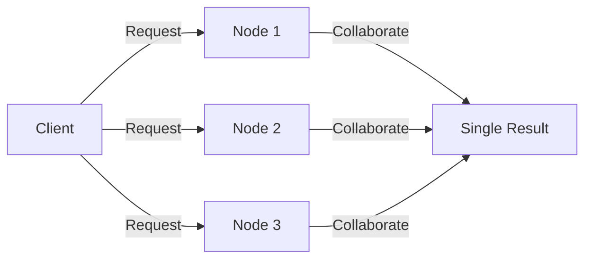
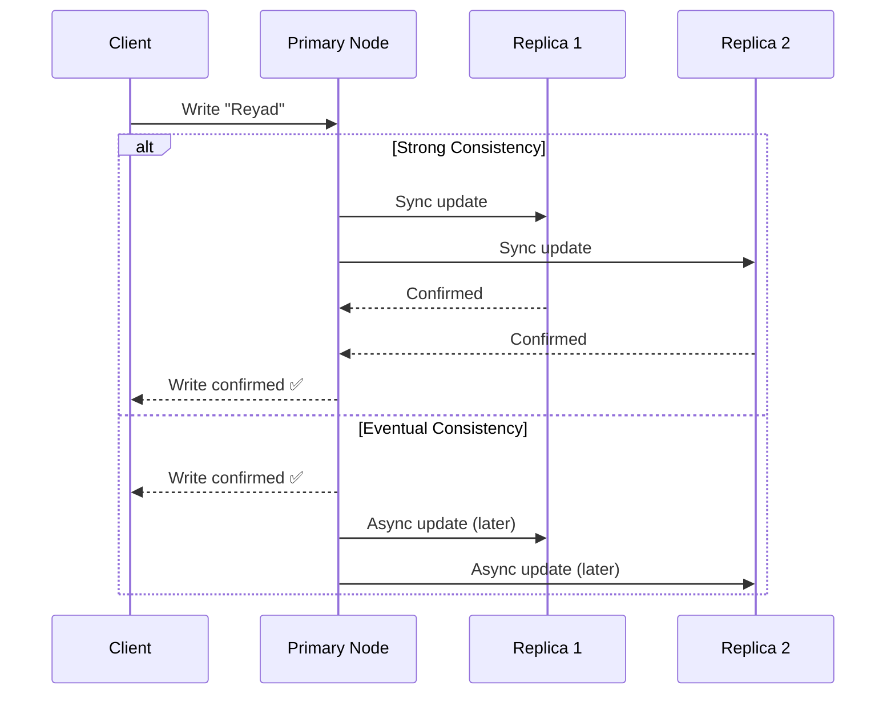
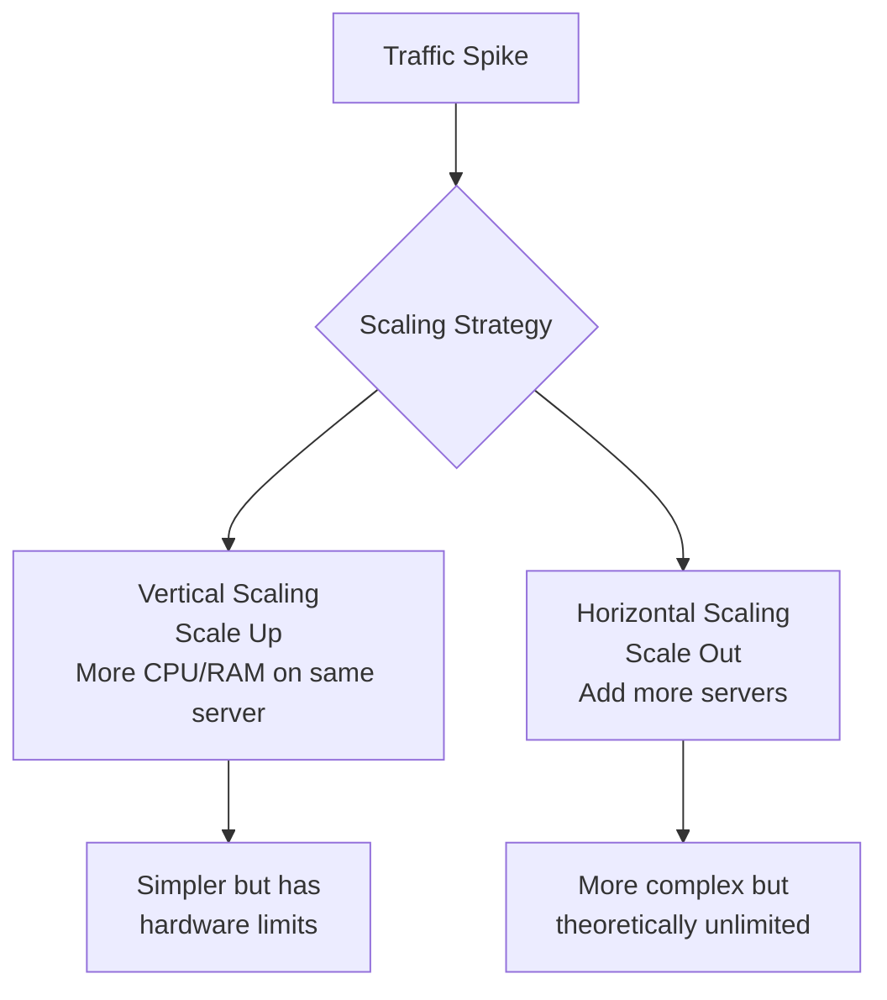
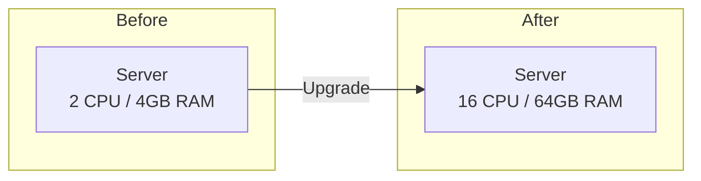
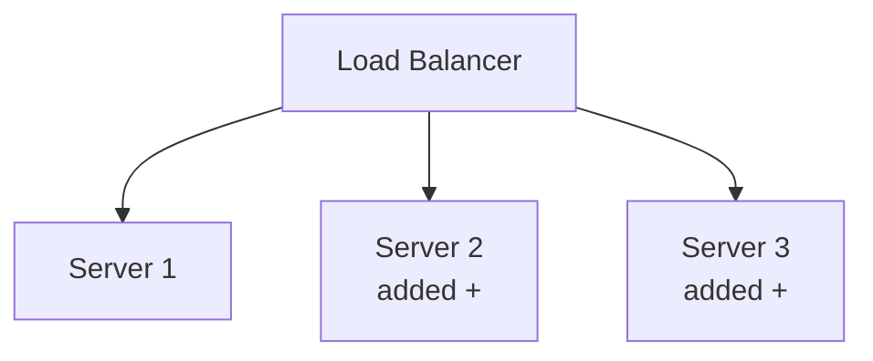
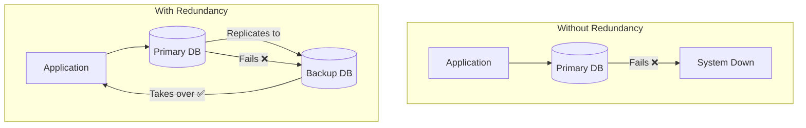
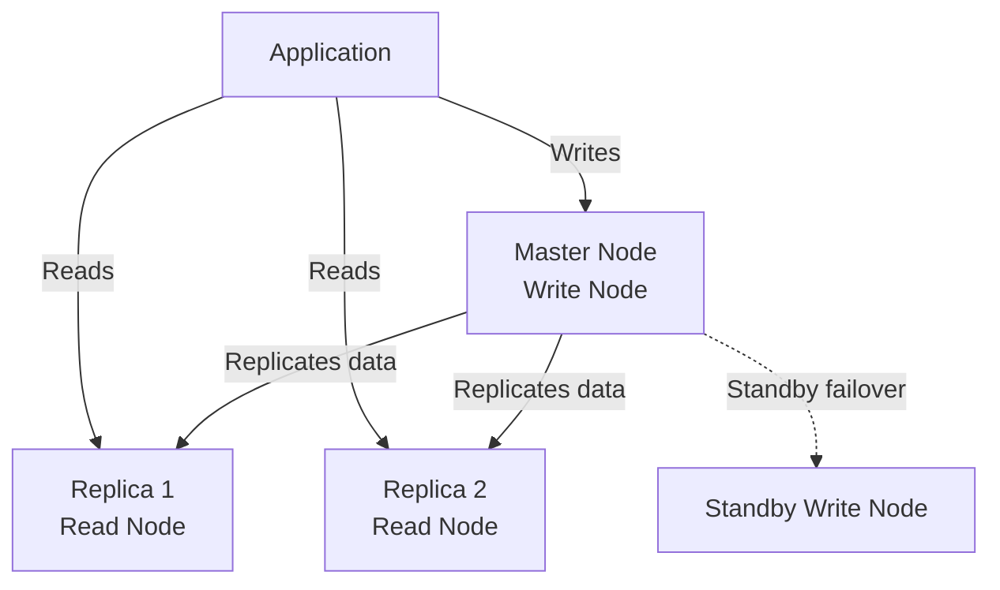
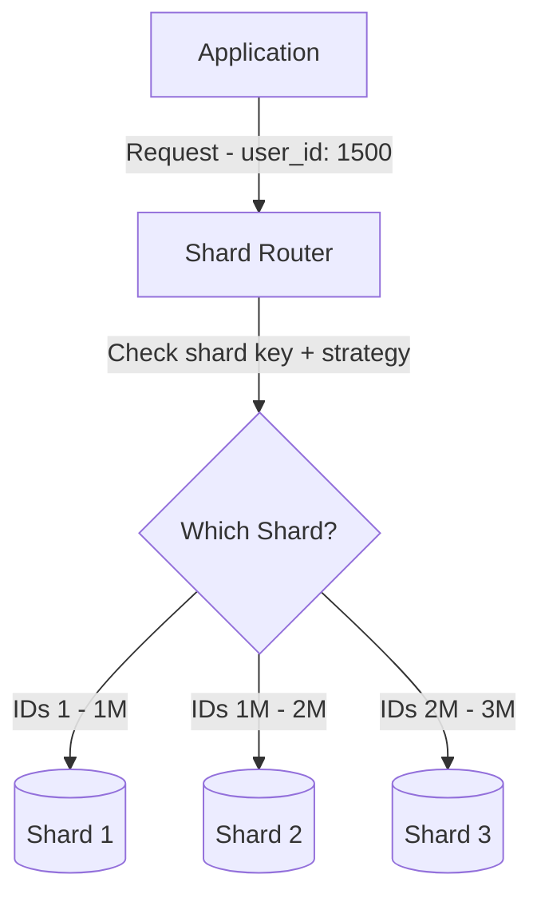

# Video 02 — System Design Terminology

> **Topic:** Key terminology essential for understanding system design — preparing for scaling applications from a few users to millions.

---

## Table of Contents

- [Distributed Systems](#distributed-systems)
- [Availability & High Availability](#availability--high-availability)
- [Reliability](#reliability)
- [Consistency](#consistency)
- [Scalability & Elasticity](#scalability--elasticity)
- [Single Point of Failure & Redundancy](#single-point-of-failure--redundancy)
- [Fault Tolerance](#fault-tolerance)
- [Database Replication & Clustering](#database-replication--clustering)
- [ACID Properties](#acid-properties)
- [Partitioning & Sharding](#partitioning--sharding)
- [Key Takeaways](#key-takeaways)

---

## Distributed Systems

- **Distributed computing** means running an application across **multiple computers (nodes)** that collaborate to produce a single result.
- Applies to backends, databases, or any service component.
- The core challenge: **coordinating nodes** to work together correctly — this underpins almost every concept in system design.



> 💡 Every concept in this video exists because of the challenges introduced by distributed systems.

---
## Availability & High Availability

- **Availability** = Is this service accessible right now when users make requests?
- **High Availability (HA)** = the system can handle node failures by **rerouting traffic** to healthy nodes **without interruption**.
- True 100% uptime is impossible — the goal is to get as close as possible.

> 💡 Example: if one sub-service goes down for any reason, the remaining services absorb its load and continue operating at the same efficiency — the user notices nothing.

### Availability "Nines"

| Nines | Availability % | Max Annual Downtime |
|---|---|---|
| 1 | 90% | ~36.5 days |
| 2 | 99% | ~3.65 days |
| 3 | 99.9% | ~8.76 hours |
| 4 | 99.99% | < 1 hour |

> ⚠️ Each additional nine costs significantly more in infrastructure and engineering effort. Five or six nines is reserved for critical systems (banking, healthcare, military).

### 🤔 Critical Thinking

**Q: If higher availability is always better, why don't all systems aim for 99.999%?**

A: Because each extra nine comes with exponentially higher cost and complexity — more redundant nodes, more sophisticated failover logic, more engineering time. A personal blog doesn't need the same uptime as a hospital's patient monitoring system. The right availability target depends on the **business cost of downtime** vs the **cost of preventing it**.

---

## Reliability

- **Reliability** = the system operates **correctly and consistently** — doing what it's supposed to do.
- A system can be **highly available but unreliable** — e.g., it responds 24/7 but returns corrupt or wrong data.
- Reliability is harder to quantify than availability; it depends on domain-specific correctness criteria.

> 🧠 Analogy: A friend who always picks up the phone (available) but never actually helps you when you call (unreliable).

### 🤔 Critical Thinking

**Q: Can you have high availability without reliability? Is that useful?**

A: Yes, and no — it's not useful. A system that is always up but gives wrong answers is worse than useless; it creates false confidence. Availability without reliability can cause real harm in domains like finance or healthcare. Both properties must be engineered together.

---

## Consistency

- **Consistency** = all users see **the same data at the same time**.
- Easy on a single server. In distributed systems with multiple nodes, it becomes a core challenge.

### Strong vs Eventual Consistency


### Strong vs Eventual Consistency

- **Strong Consistency** — you wait until **all nodes confirm** the data has been saved correctly before the write is considered complete.
- **Eventual Consistency** — the write is confirmed immediately on the primary, and updates **propagate to other nodes over time**.

> ⚠️ Strong consistency directly harms availability — while waiting for all nodes to confirm, the system is slower and more vulnerable to timeouts.


| Aspect | Strong Consistency | Eventual Consistency |
|---|---|---|
| **Data accuracy** | All nodes updated before confirming write | Write confirmed locally; replicas updated async |
| **Latency** | Higher — must wait for all nodes | Lower — fast writes |
| **Use cases** | Banking, medical records, military | Social media, general CRUD apps |
| **Downside** | Decreased availability, higher latency | Temporarily stale data |

### 🤔 Critical Thinking

**Q: Why can't we always use strong consistency and just accept the latency?**

A: In high-throughput systems, that latency adds up — millions of writes waiting for all replicas to confirm creates bottlenecks and reduces availability. Also, in geographically distributed systems, replicas may be thousands of miles apart, making synchronous replication extremely slow. The CAP theorem formalises this tension — you can't have perfect consistency AND perfect availability in a distributed system simultaneously.

---

## Scalability & Elasticity

### Scalability

- **Scalability** = the system's capacity to **handle increased workload** (e.g., traffic spikes on Black Friday).



### Vertical Scaling — Make the server bigger



### Horizontal Scaling — Add more servers



| Type | Description | Limit |
|---|---|---|
| **Vertical Scaling** | Upgrade a single server's CPU/RAM | Hard ceiling — hardware limits |
| **Horizontal Scaling** | Add more servers to share the load | Theoretically unlimited |
### Elasticity

- **Elasticity** = **automatic** scaling up AND down based on real-time workload.
- Goes beyond scalability — elasticity releases resources during low traffic, saving cost.
- Enabled by cloud providers (AWS Auto Scaling, etc.) who dynamically allocate resources.

> 💡 Scalability = can handle more load. Elasticity = automatically adjusts to current load.

### 🤔 Critical Thinking

**Q: If horizontal scaling is theoretically unlimited, why would anyone use vertical scaling?**

A: Horizontal scaling introduces complexity — you now need load balancers, distributed state management, and data consistency across nodes. For smaller systems or stateful workloads (e.g., legacy databases), vertical scaling is simpler and sufficient. Many real-world systems use both: scale vertically first, then horizontally when they hit hardware limits.

---

## Single Point of Failure & Redundancy

- **Single Point of Failure (SPOF)** = any component whose failure causes **complete system downtime**.
- **Redundancy** = having backup components ready to take over if a primary fails.



The chart shows two scenarios:

**Without Redundancy:**
- The application talks to a single Primary DB
- If that DB fails → the whole system goes down, no fallback exists

**With Redundancy:**
- The application talks to a Primary DB as normal
- The Primary DB is **constantly replicating its data** to a Backup DB in the background
- If the Primary DB fails → the Backup DB **takes over** and the application keeps running
- The user notices nothing because the Backup already has an up-to-date copy of the data

> The key idea is that the Backup DB isn't idle — it's always receiving replicated data so it's **ready to step in at any moment**.

> ⚠️ Redundancy costs more but is essential for high availability and fault tolerance. Every critical component should have a backup.

---

## Fault Tolerance

- A **fault-tolerant system** continues operating even when components fail.
- Achieved by eliminating SPOFs through **redundancy** and **replication**.
- **Database replication** = copying data from a primary node to one or more replica nodes so the system survives a primary failure.

### 🤔 Critical Thinking

**Q: Is a fully redundant system truly fault-tolerant?**

A: Not necessarily. Fault tolerance also depends on how quickly failover happens, whether the failover itself can fail, and whether the replicated data is up to date. A replica that is 10 minutes behind the primary is redundant but may not be fault-tolerant enough for a financial system. True fault tolerance requires redundancy + fast failover + data consistency.

---

## Database Replication & Clustering



| Term | Definition |
|---|---|
| **Database Cluster** | Multiple database nodes working together |
| **Master / Write Node** | Primary node where all writes occur |
| **Replica / Read Node** | Nodes that receive replicated data for reads only |
| **Synchronous Replication** | Replica confirms write before primary confirms → strong consistency |
| **Asynchronous Replication** | Primary confirms write first, replicas update later → eventual consistency |

> 💡 Common pattern: **1 write node + multiple read replicas** — offloads read traffic and improves performance without complex multi-master setups.

---

## ACID Properties

ACID is a set of properties ensuring **reliable transactions** in relational databases (e.g., PostgreSQL).

| Property | Meaning | Example |
|---|---|---|
| **Atomicity** | A transaction is all-or-nothing — fully succeeds or fully rolls back | Bank transfer: debit + credit both succeed, or neither does |
| **Consistency** | The DB always moves from one valid state to another — rules and constraints are never violated | A foreign key can never point to a non-existent record |
| **Isolation** | Concurrent transactions don't interfere with each other — each transaction works as if it is the only one running | Two users booking the last seat — only one succeeds |
| **Durability** | Once committed, data survives crashes or power failures | A confirmed order isn't lost if the server restarts |

> ⚠️ Note: **Consistency in ACID** is different from **consistency in distributed systems**. ACID consistency = valid data rules. Distributed consistency = all nodes seeing the same data.

### 🤔 Critical Thinking

**Q: Why do NoSQL databases often sacrifice ACID properties?**

A: ACID guarantees come at a performance and scalability cost — enforcing strict rules across distributed nodes requires coordination that slows things down. NoSQL databases (e.g., Cassandra, DynamoDB) trade ACID for speed and horizontal scalability, accepting eventual consistency. The right choice depends on whether your domain can tolerate temporary inconsistency.


---

### Deep Dive — Isolation

The core idea of isolation is that **TR2 cannot see or touch the data TR1 is currently working on**.

When TR1 starts working on a row, it locks it. TR2 then either waits, reads the old value, or gets blocked entirely — depending on the **isolation level** configured.

#### The Seat Booking Example

> Without isolation → both users read "seat available" simultaneously → both book → **double booking** ❌
>
> With isolation → TR2 is blocked until TR1 finishes → TR2 sees "seat taken" → only one booking ✅

Here is exactly what happens step by step:

- TR1 (User 1) starts booking → **locks the seat row**
- TR2 (User 2) tries to access the same row → **gets blocked, waits**
- TR1 commits → seat is now marked as **booked**
- TR2 unblocks → reads the row → sees the seat is **already taken** → **fails gracefully**

#### Isolation Levels

Isolation is not binary — it is a spectrum. Higher isolation = more safety, less concurrency.

| Isolation Level | What TR2 can do while TR1 is running | Risk if skipped |
|---|---|---|
| **Read Uncommitted** | Can read TR1's uncommitted changes | Dirty reads |
| **Read Committed** | Can only read data TR1 has already committed | Non-repeatable reads |
| **Repeatable Read** | Cannot read or change rows TR1 has read | Phantom reads |
| **Serializable** | Fully blocked — runs as if transactions are one after another | None — but lowest concurrency |

> 💡 **Serializable** is the strictest level — closest to "TR2 waits until TR1 is completely done." Most systems use **Read Committed** as a practical default, balancing safety and performance.

---

### 🤔 Critical Thinking

**Q: Why not always use Serializable isolation?**

A: Serializable is the safest but the slowest — every transaction blocks others, which kills performance under high concurrency. Most applications don't need that level of strictness. A social media feed can tolerate a slightly stale read. A bank transfer cannot. The right isolation level depends on how much inconsistency your domain can accept.


---

## Partitioning & Sharding

### Vertical Partitioning

Splits a table by **columns** into multiple smaller tables. Each table keeps the **same primary key** so they can always be joined back together when needed.

**Example — Original Users Table:**

| user_id | name | email | profile_pic | bio | last_login |
|---|---|---|---|---|---|
| 1 | Reyad | r@gmail.com | img.png | "Engineer..." | 2024-01-01 |

**After Vertical Partitioning:**

**Users_Core** (queried frequently):

| user_id | name | email |
|---|---|---|
| 1 | Reyad | r@gmail.com |

**Users_Profile** (queried rarely):

| user_id | profile_pic | bio | last_login |
|---|---|---|---|
| 1 | img.png | "Engineer..." | 2024-01-01 |

```sql
-- When you need full data, join on the shared primary key
SELECT * FROM Users_Core c
JOIN Users_Profile p ON c.user_id = p.user_id
WHERE c.user_id = 1
```

> 💡 Performance gain comes from the fact that most queries only need `Users_Core` — the DB scans a **much smaller, leaner table** instead of the full wide table. `Users_Profile` is only touched when you actually need that data.

> ⚠️ No router needed — the application already knows which table to query. The routing logic is baked into the application code itself.

---

### Horizontal Partitioning & Sharding

Splits a table by **rows** across multiple nodes. Each node holds a subset of the rows.

- **Horizontal Partitioning** = splitting rows within **one DB instance**
- **Sharding** = extending that across **multiple DB nodes** in a cluster

> ⚠️ A **Shard Router** is required — since the same table is split across nodes, something external must decide which node holds the specific row you're looking for.

#### How the Shard Router Works

The router needs to know two things:
1. What is the **shard key**? (e.g. `user_id`)
2. What is the **sharding strategy**? (how to map the key to a shard)

#### Strategy 1 — Range Based

The router holds a range table and checks which range the key falls in:

```
user_id 1      → 1M      → Shard 1
user_id 1M+1   → 2M      → Shard 2
user_id 2M+1   → 3M      → Shard 3
```

#### Strategy 2 — Hash Based

The router runs a hash function and routes to the result:

```
shard = hash(user_id) % number_of_shards

hash(1501) % 3 = 0  → Shard 1
hash(1502) % 3 = 1  → Shard 2
hash(1503) % 3 = 2  → Shard 3
```



> 💡 The router itself can be a **separate service** (e.g. MongoDB's `mongos`), a **library inside your app**, or **logic built into the DB cluster** itself — depends on the database technology you use.

---

### 🤔 Critical Thinking

**Q: What is the risk of a bad shard key?**

A: If you shard by a skewed attribute (e.g. country, where 80% of users are in the US), one shard gets overwhelmed while others sit idle — this is called a **hotspot**. A good shard key distributes load evenly. Common strategies include hashing the key or using a range that distributes naturally.

**Q: Why does vertical partitioning not need a router but horizontal sharding does?**

A: In vertical partitioning, different columns live in different tables — the application already knows which table holds the data it needs, so routing is implicit in the query itself. In horizontal sharding, the **same table** is split across nodes by rows — the application has no way of knowing which node holds a specific row without an external router to resolve it.

---

## Key Takeaways

- **Distributed systems** introduce coordination challenges that drive most of system design complexity.
- **Availability** (uptime) and **Reliability** (correctness) are related but distinct — you need both.
- **Strong consistency** guarantees accuracy at the cost of latency; **eventual consistency** prioritises speed with temporary staleness.
- **Scalability** = can handle more load; **Elasticity** = automatically adjusts to load in real time.
- **Redundancy** eliminates SPOFs and is the foundation of fault tolerance.
- **ACID** ensures transactional correctness in relational DBs — NoSQL often trades this for scale.
- **Sharding** is horizontal partitioning across nodes — powerful but requires careful key selection.
