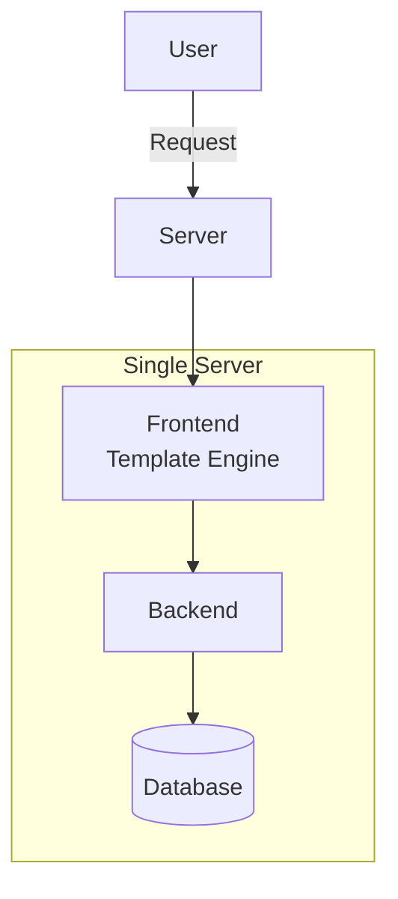
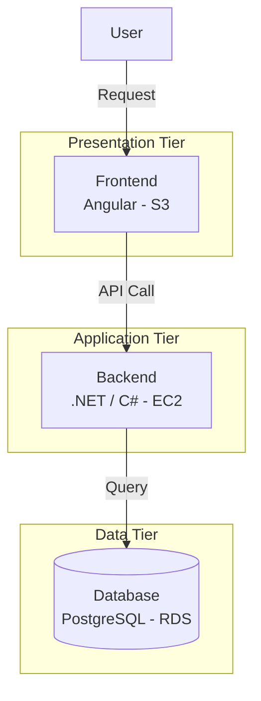
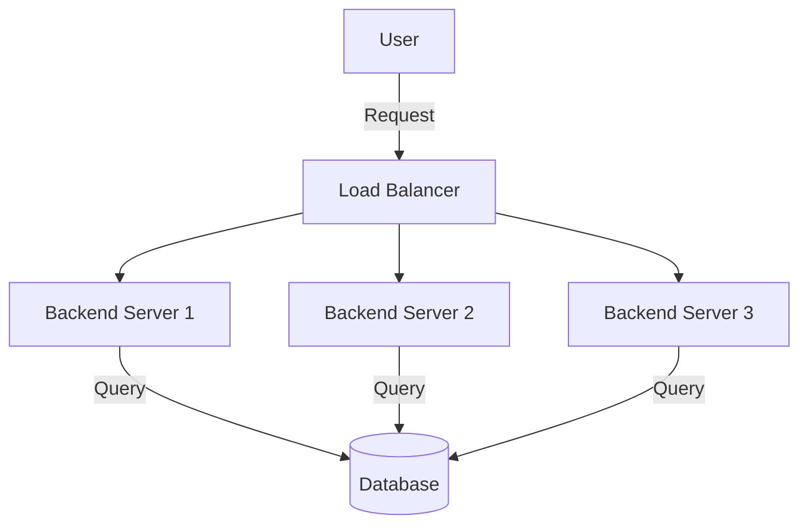
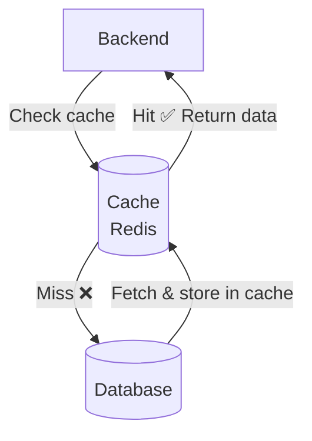
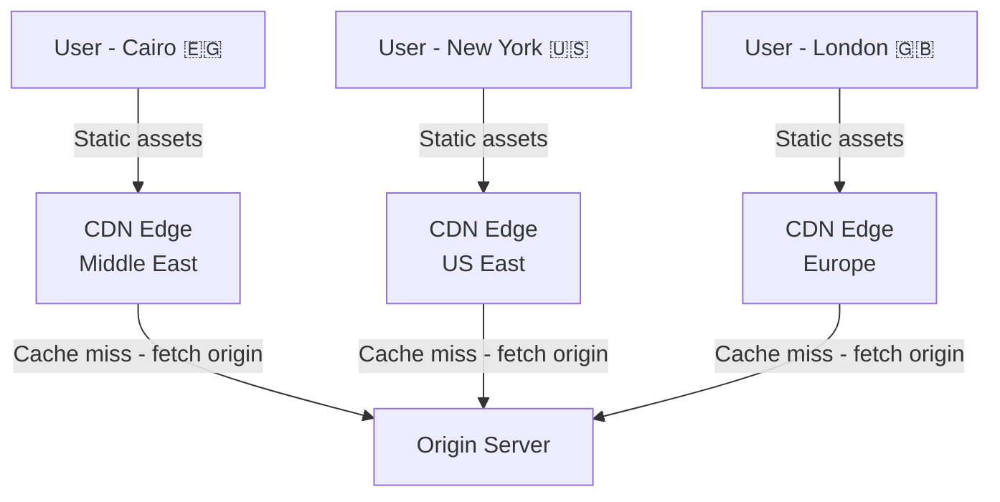
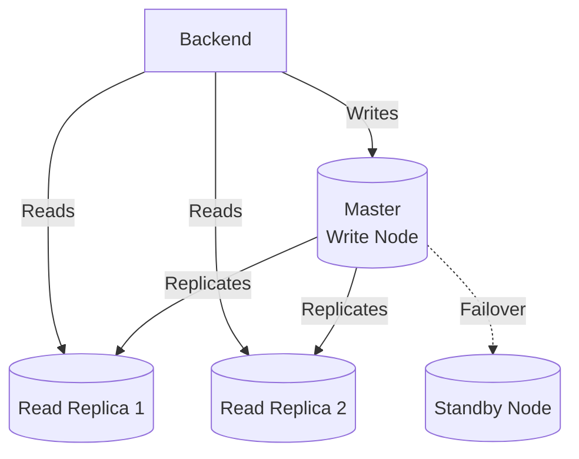
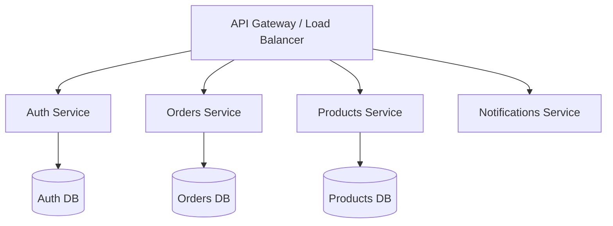
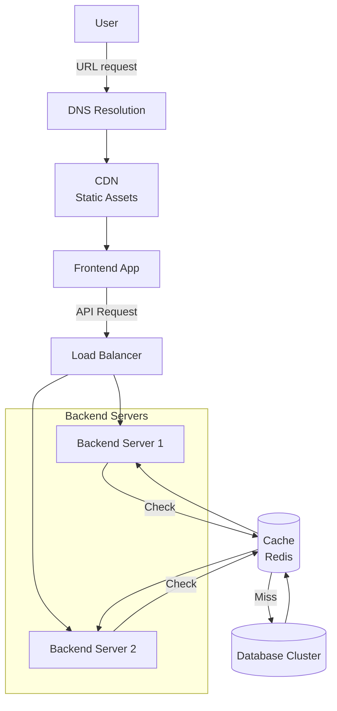

# Video 03 — App Scalability: From Monolith to Distributed Systems

> **Topic:** Scaling a web application from a small user base to millions — covering architecture evolution, caching, CDNs, load balancing, and database scaling strategies.

---

## Table of Contents

- [What is Scalability?](#what-is-scalability)
- [Vertical vs Horizontal Scaling](#vertical-vs-horizontal-scaling)
- [Autoscaling & Elasticity](#autoscaling--elasticity)
- [Stage 1 — Monolithic Single Server](#stage-1--monolithic-single-server)
- [Stage 2 — Three-Tier Architecture](#stage-2--three-tier-architecture)
- [Stage 3 — Horizontal Scaling with Load Balancer](#stage-3--horizontal-scaling-with-load-balancer)
- [Stage 4 — Caching Layer](#stage-4--caching-layer)
- [Stage 5 — CDN](#stage-5--cdn)
- [Stage 6 — Database Scaling](#stage-6--database-scaling)
- [Stage 7 — Microservices](#stage-7--microservices)
- [Full Architecture Overview](#full-architecture-overview)
- [Key Takeaways](#key-takeaways)

---

## What is Scalability?

- **Scalability** = the ability of an app to **support more users without collapsing** when reaching maximum capacity.
- A server normally runs at **50–70% capacity** — traffic spikes can push it to 90%+.
- Scalability must handle two dimensions:
  - **Short-term fluctuations** — day-to-day or seasonal traffic spikes
  - **Long-term growth** — user base expanding over months or years

---

## Vertical vs Horizontal Scaling

| Type | Description | Limit |
|---|---|---|
| **Vertical Scaling** | Upgrade a single server's CPU/RAM | Hard ceiling — hardware limits |
| **Horizontal Scaling** | Add more servers to share the load | Theoretically unlimited |

> 💡 Real-world systems typically use a **hybrid approach** — scale vertically first, then horizontally when hardware limits are reached.

> ⚠️ Horizontal scaling requires the backend to be **stateless** — if a server stores session data locally, requests routed to a different server won't find it. State must be externalised (e.g., to Redis or a DB).

## Diff Between Stateful And Stateless ... 

### Stateful vs Stateless

- **Stateful** = the server **remembers you** between requests — it stores something about you locally (e.g. your session, your login info)
- **Stateless** = the server **remembers nothing** between requests — every request carries all the information needed to process it

#### The Problem with Stateful Servers + Load Balancer

Imagine you log in and Server 1 stores your session locally:

```
Request 1 → Load Balancer → Server 1 ✅ (stores your session)
Request 2 → Load Balancer → Server 2 ❌ (no session found — who are you?)
```

Server 2 never saw your login — it has no session for you — so it treats you as a stranger. You get logged out or receive an error.

#### The Solution — Externalise the State

Instead of storing the session on the server, store it in a **shared external store** (Redis, DB) that ALL servers can access:

```
Request 1 → Load Balancer → Server 1 → reads session from Redis ✅
Request 2 → Load Balancer → Server 2 → reads session from Redis ✅
```

Now it doesn't matter which server handles your request — they all read from the same session store. The servers themselves hold **zero state** — they are stateless.

> 💡 Stateless backends are a **requirement** for horizontal scaling to work correctly. If any server stores state locally, the load balancer can't freely route requests across nodes without breaking user sessions.


---

## Autoscaling & Elasticity

- **Autoscaling** = automatic adjustment of resources (adding/removing nodes) driven by traffic demand.
- **Elasticity** = dynamic resource scaling based on real-time usage — scales **up and down**, not just up.
- Cloud providers (AWS, GCP, Azure) handle this transparently — you define thresholds, they manage the nodes.

> 💡 Scalability = *can* handle more load. Elasticity = *automatically adjusts* to current load in real time.

---

## Stage 1 — Monolithic Single Server

Everything — frontend, backend, and database — lives on **one server**.



| Pros | Cons |
|---|---|
| Simple to build and deploy | Single point of failure — server down = app down |
| Easy vertical scaling | Tightly coupled — hard to maintain and collaborate on |
| Good for prototypes | Vulnerable to DDoS attacks |
| | Vertical scaling has diminishing returns |

> ✅ Suitable for: small projects, prototypes, personal apps.

---

## Stage 2 — Three-Tier Architecture

Split the monolith into three dedicated servers — frontend, backend, and database.



- Each tier can now be **scaled independently**.
- Frontend serves static files; backend exposes APIs; database handles persistence.

> ⚠️ Introduces new challenges: **CORS configuration**, network permissions, and inter-service communication.

---

## Stage 3 — Horizontal Scaling with Load Balancer

Add multiple backend servers and a **load balancer** to distribute traffic evenly.



- Eliminates the backend as a single point of failure.
- Enables **high availability** and fault tolerance — if one node goes down, others absorb its traffic.
- Supports **autoscaling** — nodes can be added or removed dynamically.

> ⚠️ Backend must be **stateless** for load balancing to work correctly. Session state must be stored externally.

### 🤔 Critical Thinking

**Q: What happens if the load balancer itself goes down?**

A: The load balancer becomes the new single point of failure. Production systems solve this with **redundant load balancers** — a primary and a standby — with automatic failover between them. Cloud-managed load balancers (e.g. AWS ALB) handle this transparently.

---

## Stage 4 — Caching Layer

Add a **cache** between the backend and database to store frequently requested data in memory.



### How it works

- Backend first checks the cache for requested data
- **Cache hit** → return data immediately, no DB query needed
- **Cache miss** → query the DB, store result in cache, return to client

### Pros & Cons

| Pros | Cons |
|---|---|
| Drastically reduces DB load | Added architectural complexity |
| Improves speed and reduces latency | Extra code needed to manage cache reads/writes |
| Cost-effective long term | Risk of stale data if cache invalidation is not handled correctly |

> 💡 Caching 20% of the most requested data can absorb up to 80% of total DB queries — a massive performance gain for minimal storage cost.

> Common technologies: **Redis**, **Memcached** — both store data in-memory (RAM) for fast access.

### 🤔 Critical Thinking

**Q: If caching is so effective, why not cache everything?**

A: Cache lives in RAM — which is fast but expensive and limited in size. You can't cache an entire large database. More importantly, cached data can become **stale** — if the underlying DB value changes and the cache isn't invalidated, clients get outdated data. Caching is most effective for **read-heavy, rarely changing data**. Frequently updated data is a poor candidate for caching.

---


### Cache Invalidation & Sync Strategies

Keeping the cache in sync with the database is one of the most common challenges in system design. The core problem:

```
Client → writes new value → DB
                              ↑
         Cache still has      |
         the OLD value   ←────┘  (stale!)
```

---

#### Strategy 1 — Cache-Aside (Lazy Loading)

The most common pattern. The application manages the cache manually.

```
READ:
  → Check cache
  → Hit?  Return it
  → Miss? Read from DB → write to cache → return

WRITE:
  → Write to DB
  → Delete the cache key (invalidate)
```

Next read after a write will be a cache miss → fetches fresh data → repopulates cache.

| | |
|---|---|
| ✅ | Simple, widely used |
| ✅ | Cache only holds data that is actually requested |
| ❌ | First read after invalidation is always a cache miss |
| ❌ | If you forget to invalidate on write, stale data persists |

---

#### Strategy 2 — Write-Through

Every write goes through the cache first, then to the DB synchronously.

```
WRITE:
  → Write to cache
  → Immediately write to DB
  → Both always in sync
```

| | |
|---|---|
| ✅ | Cache is always fresh |
| ❌ | Every write has added latency — two writes per operation |
| ❌ | Cache may hold data that is never read again (cache pollution) |

---

#### Strategy 3 — Write-Behind (Write-Back)

Write to cache immediately, DB write is deferred and handled asynchronously.

```
WRITE:
  → Write to cache (fast, return to client)
  → Queue DB write asynchronously
```

| | |
|---|---|
| ✅ | Very fast writes — client doesn't wait for DB |
| ❌ | Risk of data loss if cache crashes before DB write completes |
| ❌ | More complex to implement correctly |

---

#### Strategy 4 — TTL-Based Expiry

Set a Time-To-Live on every cache key. Stale data auto-expires after the TTL.

```
SET key value EX 300   ← expires in 5 minutes
```

| | |
|---|---|
| ✅ | Dead simple — zero extra logic |
| ✅ | Good safety net combined with other strategies |
| ❌ | Stale data lives for up to TTL seconds — eventual consistency only |

---

#### How Do You Know if a DB Value Has Changed?

| Approach | Description | When to use |
|---|---|---|
| **Application-level invalidation** | Your code explicitly deletes the cache key on every DB write | Most common — simple and effective |
| **Change Data Capture (CDC)** | Listen to DB change log (e.g. Postgres WAL via Debezium) and invalidate automatically | Multi-service systems where multiple services write to the same DB |
| **Versioning / ETags** | Store a version number alongside the cached value and compare on read | When you need precise staleness detection |

> 💡 In practice: **Cache-Aside + explicit invalidation on write + TTL as a safety net** is the most common production combination. CDC is brought in when you have multiple services writing to the same DB and can't rely on application-level invalidation alone.

---

### 🤔 Critical Thinking

**Q: Why not just set a very short TTL and rely on expiry for everything?**

A: A very short TTL means the cache expires so frequently it barely helps — you end up hitting the DB almost every request, defeating the purpose. A very long TTL risks serving stale data for too long. TTL alone is not enough — it should be a **safety net**, not the primary invalidation strategy. Explicit invalidation on write is always more precise and reliable.


## Stage 5 — CDN

A **Content Delivery Network** caches static assets (HTML, CSS, JS, images, videos) on **edge servers distributed globally**, serving content from the location closest to the user.



| Pros | Cons |
|---|---|
| Reduces latency — content served closer to user | Cache expiration management (TTL) adds complexity |
| Reduces load on origin servers | Risk of serving stale content if misconfigured |
| Built-in DDoS protection | Does not eliminate backend API scaling needs |
| Can improve SEO | |

> 💡 Major CDN providers: **Cloudflare**, **Akamai**, **Amazon CloudFront**.

---

## Stage 6 — Database Scaling

Databases are typically the **hardest layer to scale** — they require careful strategy.



### Scaling Strategies — in order of complexity

| Strategy | Description |
|---|---|
| **Vertical Scaling** | Upgrade DB server resources first — simplest approach |
| **Read Replicas** | One write node + multiple read-only replicas — offloads read traffic |
| **Standby Node** | Replica ready to take over if primary fails — high availability |
| **Sharding / Partitioning** | Split data across multiple nodes — horizontal DB scaling |
| **Multi-Master Clustering** | Multiple active write nodes — complex, advanced use cases |
| **Separate focused DBs** | Split monolithic DB into smaller purpose-specific databases |

> 💡 The right strategy depends on whether your workload is **read-heavy** (replicas help) or **write-heavy** (sharding or multi-master needed).

---

## Stage 7 — Microservices

Split the backend into **smaller, independently deployable services**, each focused on a specific domain.



- Each service can be **scaled independently** based on its own load.
- Teams can deploy services independently without affecting others.
- Each service can use the **most appropriate DB technology** for its use case.


### Load Balancer & API Gateway

Split the backend into **smaller, independently deployable services**, each focused on a specific domain.

The API Gateway sits in front of all services and routes each request to the correct service based on the URL path:

```
/api/auth/*         → Auth Service
/api/orders/*       → Orders Service
/api/products/*     → Products Service
/api/notifications/ → Notifications Service
```

#### API Gateway / Load Balancer Options

| Tool | Description |
|---|---|
| **Traefik** | Popular reverse proxy built for containerised environments (Docker, Kubernetes) — auto-discovers services |
| **Nginx** | Classic reverse proxy / load balancer — widely used, highly configurable |
| **AWS ALB** | Amazon's Application Load Balancer — cloud managed, routes by path/host |
| **Kong** | API Gateway with built-in rate limiting, auth, and logging plugins |
| **Ocelot** | API Gateway built specifically for **.NET / C#** — fits the stack perfectly |

> 💡 In a **.NET / C# + Angular** stack, **Ocelot** is the most natural fit as the API Gateway — it handles routing, load balancing, and integrates with authentication middleware, all within the .NET ecosystem.

#### Pros & Cons

| Pros | Cons |
|---|---|
| Each service scales independently based on its own load | Significant operational complexity |
| Teams can deploy services independently | Inter-service communication needs to be managed |
| Each service can use the most appropriate DB technology | Distributed tracing and debugging is harder |
| Failure in one service doesn't bring down the whole system | Don't move to microservices prematurely |
> ⚠️ Microservices add significant complexity — inter-service communication, distributed tracing, and orchestration all need to be managed carefully. Don't move to microservices prematurely.
---

## Full Architecture Overview

The complete request flow end-to-end:



| Layer | Purpose |
|---|---|
| **DNS** | Resolves URL to IP address |
| **CDN** | Serves static assets from nearest edge server |
| **Frontend** | Renders UI, makes API calls to backend |
| **Load Balancer** | Distributes traffic across backend nodes |
| **Backend Servers** | Handle business logic, stateless |
| **Cache** | Reduces DB load for frequent reads |
| **Database Cluster** | Persistent storage with replication and scaling |

---

## Key Takeaways

- Start simple — a monolith is fine for early-stage apps. Don't over-engineer upfront.
- Separate concerns early by splitting frontend, backend, and database into distinct tiers.
- Use a **load balancer** + multiple backend nodes to eliminate SPOFs and enable horizontal scaling.
- A **cache layer** (Redis) absorbs the majority of read traffic and dramatically improves performance.
- A **CDN** reduces latency for static assets and offloads origin servers.
- Scale databases **vertically first**, then use read replicas before reaching for sharding or multi-master.
- **Microservices** offer fine-grained scalability but come with significant operational complexity — earn it, don't start with it.
