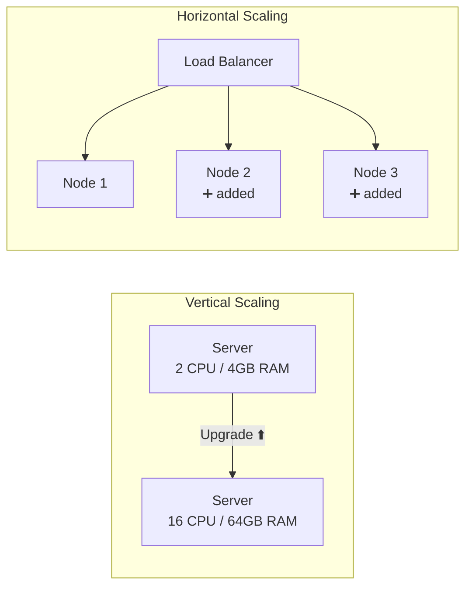
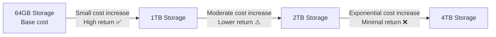
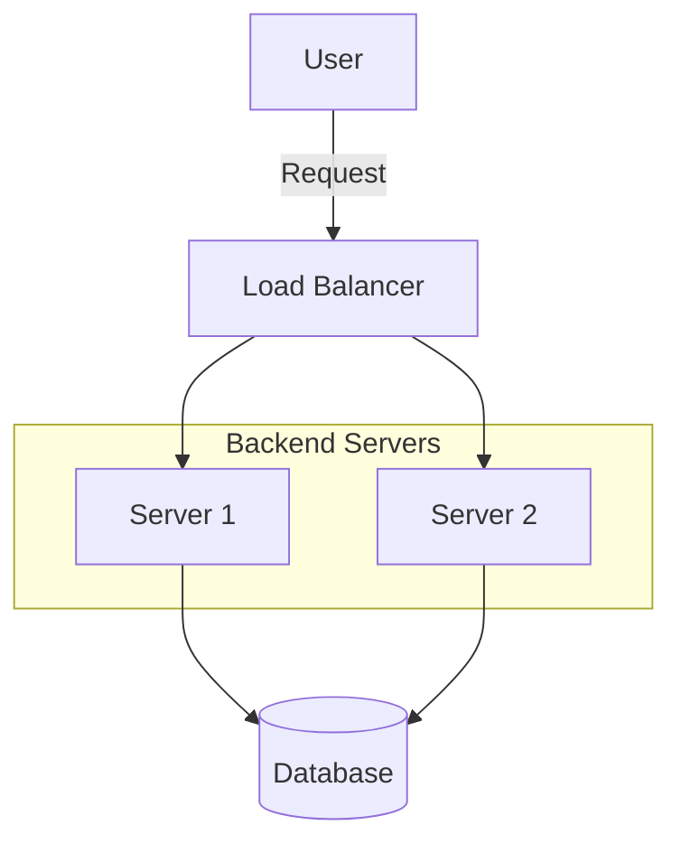
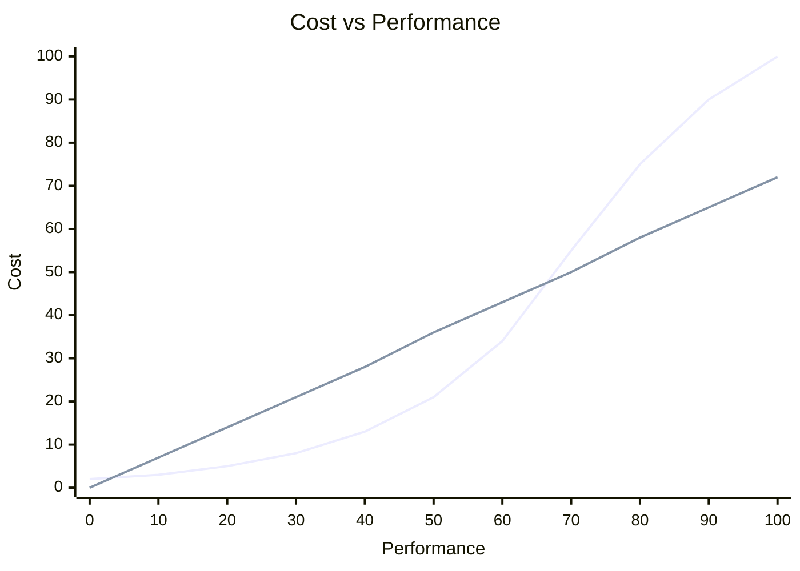
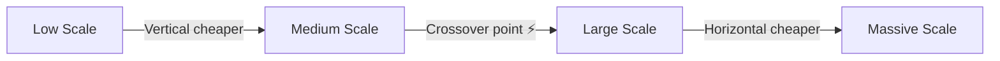
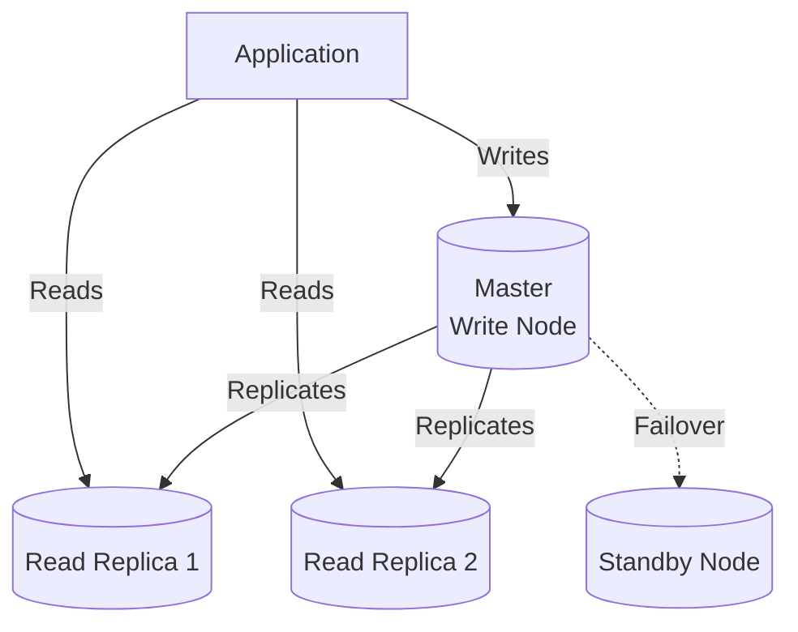

# Video 04 — Horizontal & Vertical Scaling: A Deep Dive

> **Topic:** A detailed theoretical breakdown of horizontal and vertical scaling — when to use each, cost trade-offs, and practical recommendations per service type.

---

## Table of Contents

- [What is Scaling?](#what-is-scaling)
- [Cloud vs On-Premise Scaling](#cloud-vs-on-premise-scaling)
- [Vertical Scaling — Scale Up](#vertical-scaling--scale-up)
- [Horizontal Scaling — Scale Out](#horizontal-scaling--scale-out)
- [Stateless Backend — Why it Matters for Scaling](#stateless-backend--why-it-matters-for-scaling)
- [Cost Trade-offs](#cost-trade-offs)
- [Scaling Strategy Per Layer](#scaling-strategy-per-layer)
- [Key Takeaways](#key-takeaways)

---

## What is Scaling?

- **Vertical Scaling (Scale Up)** — enhance a single server by adding more CPU, RAM, disk, or network bandwidth. Like making a skyscraper taller.
- **Horizontal Scaling (Scale Out)** — add more servers of the same capacity working collectively as one service. Like building more buildings in a city.



> 💡 There is no universal answer — the right choice depends on the **service type**: API, database, frontend, cache, etc.

---

## Cloud vs On-Premise Scaling

| | On-Premise | Cloud |
|---|---|---|
| **Hardware** | Physical constraints — limited rack space, hardware-bound upgrades | Virtualised — allocate and reallocate resources instantly |
| **Scaling speed** | Slow — requires ordering and installing physical hardware | Fast — spin up new instances in minutes |
| **Cost model** | High upfront CapEx | Pay-as-you-go OpEx |
| **Flexibility** | Low | High |

> 💡 The same scaling principles apply in both environments — but cloud virtualisation makes horizontal scaling significantly easier and faster to execute.

---

## Vertical Scaling — Scale Up

Upgrading the resources of a single server:

| Component | What it affects |
|---|---|
| **CPU** | Processing power — handles computation |
| **RAM** | Memory — holds active data and processes |
| **Disk** | Storage speed and capacity (SSD vs HDD) |
| **Network Bandwidth** | Data transfer speed in and out of the server |

### Resource Utilisation Targets

The goal is to keep peak utilisation around **75%** — enough headroom to handle traffic spikes without crashing.

| Resource | Before Scaling | After Doubling All Resources | After Doubling CPU Only |
|---|---|---|---|
| **CPU** | 90% 🔴 | 45% ✅ | 45% ✅ |
| **RAM** | 20% ✅ | 10% ✅ | 20% ✅ |
| **Disk** | 20% ✅ | 10% ✅ | 20% ✅ |
| **Network** | 20% ✅ | 10% ✅ | 20% ✅ |

> 💡 In this example, only CPU was the bottleneck — doubling only the CPU was the right move. Doubling all resources would waste money on RAM, Disk, and Network that didn't need upgrading. Always **monitor first, then scale the bottleneck**.

### Diminishing Returns

Vertical scaling becomes increasingly expensive at higher performance levels:



> ⚠️ Doubling capacity at high performance levels often costs **more than double**. This is why vertical scaling alone is not a long-term strategy.

---

## Horizontal Scaling — Scale Out

Add more servers and distribute traffic across them via a **load balancer**.



### Benefits

- Eliminates single point of failure — if one node goes down, others absorb its traffic
- Enables **high availability** and fault tolerance
- Supports **autoscaling** — nodes added or removed dynamically based on load
- More cost-efficient than vertical scaling beyond a certain threshold

### Recommended Approach


1. **Step 1** — Vertically scale to a balanced resource utilisation
2. **Step 2** — Horizontally scale to at least **2 nodes** for high availability and failover
3. **Step 3** — From there, balance both strategies based on traffic and cost

> ⚠️ Avoid running on extremely low-spec nodes that require too many instances to compensate. Find the right balance between node size and number of nodes.

---

## Stateless Backend — Why it Matters for Scaling

For horizontal scaling to work correctly, the backend **must be stateless** — it should not store any application state or user data locally on the server.

### Stateful vs Stateless

- **Stateful** = the server remembers you between requests — stores session data locally
- **Stateless** = the server remembers nothing — every request carries all the information needed

### The Problem with Stateful Servers + Load Balancer

```
Request 1 → Load Balancer → Server 1 ✅ (stores your session locally)
Request 2 → Load Balancer → Server 2 ❌ (no session found — who are you?)
```

### The Solution — Externalise the State

Store session data in a **shared external store** (Redis, DB) that all servers can access:

```
Request 1 → Load Balancer → Server 1 → reads session from Redis ✅
Request 2 → Load Balancer → Server 2 → reads session from Redis ✅
```

> 💡 Stateless backends are a **requirement** for horizontal scaling to work correctly. The database must also be **decoupled from the API server** and run separately — otherwise multiple API servers would each try to manage their own database instance.

---

## Cost Trade-offs

| Scaling Type | Cost Characteristic | Best For |
|---|---|---|
| **Vertical** | Cost increases exponentially at high performance | Early stage, simpler to implement |
| **Horizontal** | Steep upfront cost but lower incremental cost after | Large scale, long-term cost efficiency |

### Cost Crossover Point



> — Vertical scaling cost grows **exponentially** (upper curve)
> — Horizontal scaling cost grows **linearly** (lower line)
> — The intersection is the **crossover point** — beyond this, stop scaling vertically and start scaling horizontally.



> 💡 There is a **crossover point** where horizontal scaling becomes more cost-effective than continuing to vertically scale. In cloud environments, this crossover happens later due to virtualisation benefits — but it always arrives eventually.

### 🤔 Critical Thinking

**Q: If horizontal scaling is more cost-effective at large scale, why not start with it immediately?**

A: Horizontal scaling adds complexity — load balancers, stateless architecture, distributed state management, and more infrastructure to manage. For early-stage apps with low traffic, this complexity is not justified. Start simple, scale vertically first, then introduce horizontal scaling when the complexity is actually warranted by the traffic.

---

## Scaling Strategy Per Layer

Each layer of the architecture has a different optimal scaling strategy:

### Frontend

- Host static files on **serverless platforms** (e.g. AWS S3)
- No scaling complexity — the cloud provider handles it transparently
- CDN handles global distribution

#### Serverless Platforms

Serverless does not mean there are no servers — it means **you don't see or manage them**. The servers exist, but they are 100% the cloud provider's responsibility. You just deploy code and it runs.

**Virtualization vs Serverless:**

Virtualization = taking one physical machine and splitting it into multiple **virtual machines (VMs)**, each acting like an independent server. You still manage the OS, runtime, and scaling yourself.

```
Physical Server
├── VM 1 (you manage it)
├── VM 2 (you manage it)
└── VM 3 (you manage it)
```

Serverless = you write your code and deploy it — the cloud provider manages **everything else** — no servers, no VMs, no OS, no scaling configuration.

```
You → write function / code → deploy to AWS Lambda
AWS handles:
  ├── provisioning servers
  ├── scaling up and down
  ├── OS and runtime updates
  └── you only pay when your code actually runs
```

| | Virtualization (EC2) | Serverless (Lambda / S3) |
|---|---|---|
| **You manage** | OS, runtime, scaling, updates | Nothing — just your code |
| **Scaling** | You configure it | Automatic and instant |
| **Cost model** | Pay per hour the server is running | Pay per execution — idle = free |
| **Control** | Full control | Limited control |
| **Examples** | AWS EC2, Google Compute Engine | AWS Lambda, AWS Fargate, AWS S3 |

> 💡 The reason serverless is great for frontend hosting (like Angular on S3) is that S3 just serves your static files automatically — you never configure a server, never worry about traffic spikes, and never pay for idle time.

---

### Backend API

- Must be **stateless**
- Vertically scale first to balanced utilisation (~75% peak)
- Then horizontally scale to at least 2 nodes for high availability
- Use load balancer + autoscaling for dynamic capacity

---

### Database (Relational — PostgreSQL)



- Prefer **vertical scaling first** — distributed data consistency makes horizontal scaling complex
- Add a **standby node** for failover and high availability
- Use **read replicas** for horizontal scaling of read-heavy workloads
- **Multi-master clustering** only when write load genuinely demands it — complex and should not be adopted prematurely

---

### Database (NoSQL)

- Designed for **easy horizontal scaling** from the ground up
- Supports multi-master and distributed write/read architectures natively
- Better suited for write-heavy workloads (e.g. messaging apps)

#### Why NoSQL is Designed for Easy Horizontal Scaling

Relational databases (PostgreSQL etc.) were invented in the 1970s — when applications ran on a **single machine**. The whole design assumes one source of truth, strict schemas, and ACID transactions. Distributing that across nodes is painful because it was never the original intent.

NoSQL databases were invented **after** the internet scaled massively — Google, Amazon, Facebook needed to handle billions of writes across thousands of servers. So they were **designed from day one** with distribution in mind — no strict schema, no complex joins, no single master requirement.

> 💡 Relational DB = built for correctness on one machine, distribution added later with difficulty. NoSQL = built for distribution first, correctness is your responsibility.

#### Multi-Master in NoSQL

In a relational DB, multi-master is complex and painful because every write node needs to agree on every transaction — conflicts are hard to resolve when two nodes write to the same row simultaneously.

NoSQL sidesteps this by relaxing the rules:

```
Relational multi-master:
Write to Node 1 AND Node 2 simultaneously → conflict ❌
Who wins? Complex resolution needed.

NoSQL multi-master (e.g. Cassandra):
Write to Node 1 AND Node 2 simultaneously → both accepted ✅
Last write wins (by timestamp) — conflict resolved automatically.
```

NoSQL accepts **eventual consistency** as the trade-off — all nodes will agree eventually, but not necessarily immediately. This makes multi-master simple and natural.

#### Why NoSQL is Better for Write-Heavy Workloads

Take a messaging app — WhatsApp, Slack. Every second millions of messages are being sent and read simultaneously.

In a relational DB with one master write node:

```
All writes → Single master node → bottleneck 🔴
```

In Cassandra (NoSQL):

```
Write → any of 10 nodes ✅
Each node handles its share of writes
No bottleneck
```

NoSQL also typically writes to memory first then flushes to disk — making individual writes extremely fast compared to relational DBs that enforce ACID on every write.

#### Summary

| | Relational (PostgreSQL) | NoSQL (Cassandra, MongoDB) |
|---|---|---|
| **Original design** | Single machine, correctness first | Distributed, scale first |
| **Multi-master** | Complex, conflict-prone | Native, eventual consistency handles conflicts |
| **Write-heavy** | Bottlenecks at single master | Writes distributed across all nodes |
| **Trade-off** | Strong consistency, harder to scale | Easy to scale, weaker consistency |

> 💡 The fundamental difference is the trade-off choice — relational DBs choose **consistency over scalability**, NoSQL chooses **scalability over consistency**. Neither is wrong — it depends on what your application needs more.

#### 🤔 Critical Thinking

**Q: Why is horizontal scaling harder for relational databases than for stateless APIs?**

A: A stateless API holds no data — you can add 10 identical nodes and they all behave the same way. A relational database is inherently stateful — it holds the data. When you distribute it across nodes, you immediately face questions like: which node is the source of truth? What happens when two nodes get conflicting writes? How do you keep them in sync? These distributed consistency problems don't exist in a stateless API but are fundamental to databases — which is why vertical scaling is preferred for relational DBs and horizontal scaling requires very careful strategy.

---

## Key Takeaways

- **Vertical scaling** = upgrade one server. Simple but hits a hard ceiling with exponentially increasing costs.
- **Horizontal scaling** = add more servers. More complex but theoretically unlimited and more cost-efficient at scale.
- Always **monitor resource utilisation first** — scale the bottleneck, not everything blindly.
- Target **~75% utilisation at peak** — enough headroom to handle spikes without crashing.
- The recommended pattern: **vertical first → then horizontal to at least 2 nodes → then balance both**.
- Backend APIs **must be stateless** for horizontal scaling to work — externalise all state to Redis or DB.
- Relational databases prefer **vertical scaling** — horizontal scaling introduces distributed consistency complexity.
- NoSQL databases are built for **horizontal scaling** natively.
- **Serverless platforms** (S3, Lambda, Fargate) eliminate scaling complexity for frontend and some backend components.
