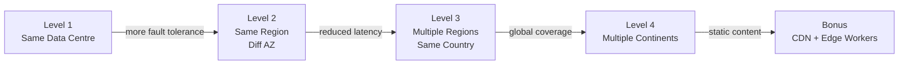
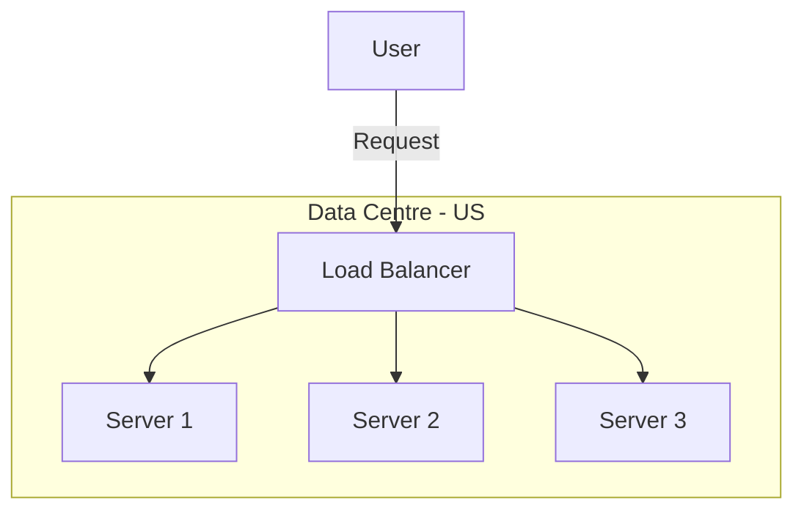
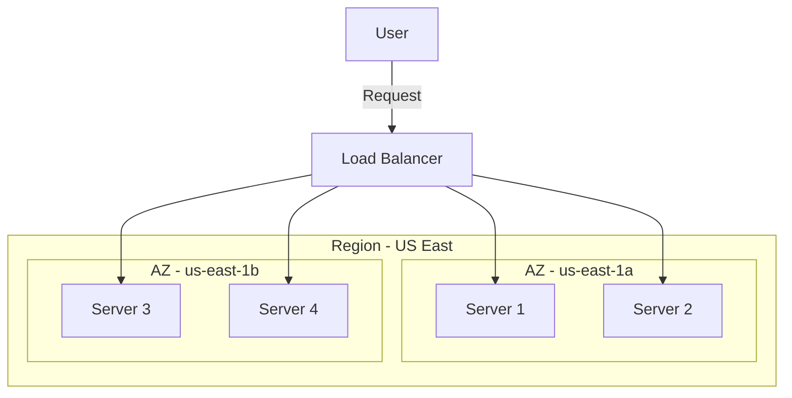
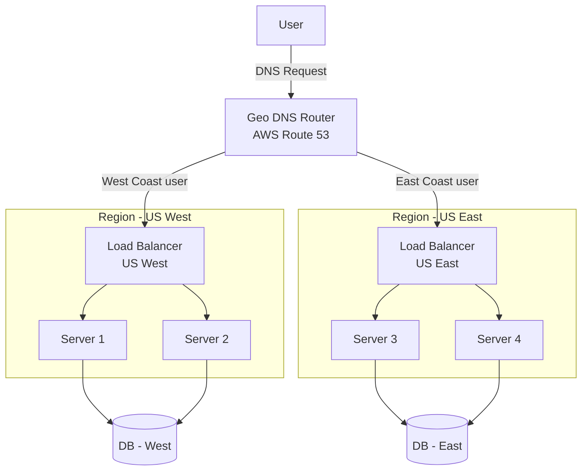
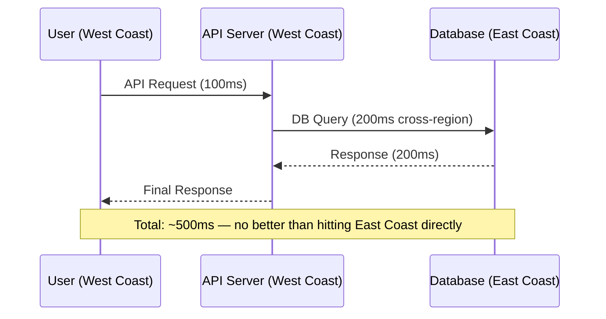
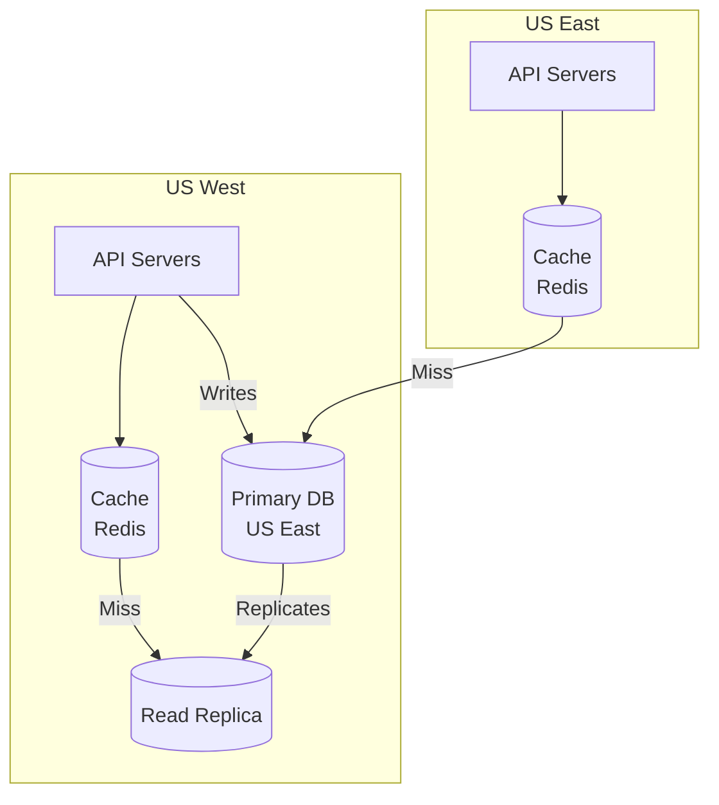
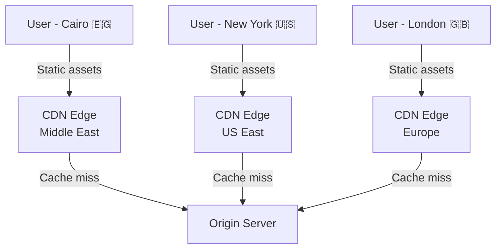
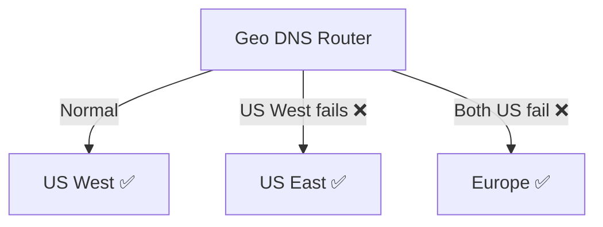

# Video 05 — Global App Scaling

> **Topic:** Scaling an application globally — understanding how server placement across data centres, availability zones, regions, and continents impacts latency, availability, and complexity.

---

## Table of Contents

- [The Infrastructure Hierarchy](#the-infrastructure-hierarchy)
- [Scaling Levels Overview](#scaling-levels-overview)
- [Level 1 — Same Data Centre](#level-1--same-data-centre)
- [Level 2 — Same Region, Different Availability Zones](#level-2--same-region-different-availability-zones)
- [Level 3 — Multiple Regions](#level-3--multiple-regions)
- [Level 4 — Multiple Continents](#level-4--multiple-continents)
- [The Cross-Region Database Latency Problem](#the-cross-region-database-latency-problem)
- [Solutions to Cross-Region DB Latency](#solutions-to-cross-region-db-latency)
- [CDN & Edge Workers in Global Scaling](#cdn--edge-workers-in-global-scaling)
- [Multi-Region Failover](#multi-region-failover)
- [Key Takeaways](#key-takeaways)

---

## The Infrastructure Hierarchy

Before discussing global scaling, it is important to understand the hierarchy of physical infrastructure:

```
Server
  └── Rack (holds multiple servers)
        └── Data Centre (holds multiple racks — thousands of servers)
              └── Availability Zone (one or more data centres)
                    └── Region (multiple availability zones)
                          └── Global (multiple regions across continents)
```

> 💡 When AWS says "us-east-1" is a region — that region contains multiple **availability zones** (us-east-1a, us-east-1b, us-east-1c), and each availability zone contains one or more **physical data centres** with thousands of servers inside.

---

## Scaling Levels Overview



| Level | Location Strategy | Solves | Does Not Solve |
|---|---|---|---|
| **1** | Same data centre | Availability, capacity | Latency for distant users |
| **2** | Same region, different AZ | Fault tolerance, HA | Latency for distant users |
| **3** | Multiple regions | Latency per region, HA | Cross-region DB latency |
| **4** | Multiple continents | Global latency, legal compliance | Complexity, cost |
| **CDN** | Global edge servers | Static content latency | Dynamic API latency |

---

## Level 1 — Same Data Centre

All servers live in the **same physical building** — the load balancer distributes traffic across them.



**What it solves:**
- If one server fails → others absorb the traffic ✅
- Can handle more concurrent users ✅

**What it does NOT solve:**
- A user in Cairo still travels the same distance to reach any of the servers ❌
- Adding more servers in the same building does not make the building closer to the user

> 💡 Think of it like a restaurant in New York adding more chefs — it can serve more customers faster, but if you are in Cairo you still have to fly to New York to eat there. More chefs don't make the flight shorter.

---

## Level 2 — Same Region, Different Availability Zones

Servers are distributed across **multiple availability zones** within the same region — physically separate data centres connected with fast private networking.



**What it solves:**
- If an entire data centre loses power or goes down → servers in other AZs keep running ✅
- Higher fault tolerance than single data centre ✅

**What it does NOT solve:**
- AZs in the same region are close together — latency improvement for distant users is minimal ❌

> 💡 Recommended as a simple yet effective first step to improve availability without adding much complexity. Most production systems should be at least at this level.

---

## Level 3 — Multiple Regions

Servers are placed in **different geographical regions** — e.g. US East Coast and US West Coast. A **geolocation DNS router** directs each user to the nearest region.



**What it solves:**
- Users are routed to the nearest region → reduced latency ✅
- If one region goes down → DNS reroutes to another region ✅
- Each region can be scaled independently based on local traffic ✅

**What it introduces:**
- Geolocation DNS routing setup (e.g. AWS Route 53)
- Independent load balancers per region
- Database replication across regions — the hard part

---

## Level 4 — Multiple Continents

Going truly global means placing servers on **different continents** — Europe, Asia, Middle East etc. This introduces all the complexity of multi-region plus legal and compliance challenges.

| Challenge | Description |
|---|---|
| **Data Privacy Laws** | GDPR in Europe requires user data to stay within EU borders |
| **Data Localisation** | Some countries require data to be stored within national borders |
| **Compliance** | Health records, financial data, government data all have strict regulations |
| **Cost** | Cross-continent data transfer is expensive |
| **Complexity** | Inter-region service communication, replication, and routing all increase significantly |

> ⚠️ Legal and compliance requirements vary heavily by country and data type. Always research the specific regulations for your target regions — this is not optional.

---

## The Cross-Region Database Latency Problem

This is the most critical challenge in multi-region deployments. Moving servers closer to users **does not help** if the database is still far away.



**The problem:**

```
Scenario A — User hits West Coast server:
User → West Coast API (100ms) → East Coast DB (200ms) = 300ms total

Scenario B — User hits East Coast server:
User → East Coast API (200ms) → East Coast DB (100ms) = 300ms total
```

Both scenarios result in the **same total latency** — the gain from having a nearby server is completely cancelled out by the cross-region DB query.

> 💡 This is why database architecture is the hardest part of global scaling. You can't just deploy servers globally and call it done — the database layer must be addressed too.

---

## Solutions to Cross-Region DB Latency

| Solution | Description | Pros | Cons |
|---|---|---|---|
| **Multi-Primary DB** | Multiple writable nodes in different regions | Writes are local to each region — low latency | Complex consistency management, write conflicts |
| **Read Replicas** | Primary write node in one region, read-only replicas in others | Simple, improves read latency per region | Write latency still depends on primary region |
| **Caching** | Cache layer per region reduces DB hits | Reduces DB load significantly | Cache invalidation complexity, stale data risk |



> 💡 The most common production pattern: **Primary DB in one region + Read Replicas in other regions + Cache layer per region**. Writes always go to the primary, reads are served locally. This gives the best balance of consistency and latency.

### 🤔 Critical Thinking

**Q: If read replicas solve read latency, what about write-heavy apps across regions?**

A: Read replicas don't help write-heavy apps — all writes still travel to the primary region. For write-heavy global apps you need **multi-primary databases** (like Cassandra or CockroachDB) which accept writes in any region. The trade-off is consistency complexity — you must handle write conflicts when two regions write to the same data simultaneously. This is why write-heavy global scaling is significantly harder than read-heavy.

---

## CDN & Edge Workers in Global Scaling

### CDN — Static Content

CDNs distribute **static assets** (HTML, CSS, JS, images, videos) to edge servers globally — serving content from the location nearest to the user.



> 💡 Implement a CDN early — it is the simplest way to get immediate global performance gains with minimal complexity.

### Edge Workers — Backend Logic at the Edge

Edge Workers (e.g. **Cloudflare Workers**) go beyond static content — they run **backend logic** at the edge, physically close to the user.

```
Without Edge Workers:
User (Cairo) → API Server (US) → Response   [high latency]

With Edge Workers:
User (Cairo) → Edge Worker (Cairo/Dubai) → Response   [low latency]
```

- Can handle authentication, personalisation, A/B testing, API responses at the edge
- Essentially a **distributed backend** — logic runs closest to where the user is
- Significantly reduces latency for dynamic content without full multi-region deployment

> 💡 Edge Workers are a powerful middle ground between a simple CDN (static only) and a full multi-region deployment (very complex). They let you run real logic globally without managing full server infrastructure per region.

---

## Multi-Region Failover

Multi-region deployment also enables **automatic failover** — if one region goes down entirely, the geo DNS router redirects all traffic to the next nearest healthy region.



- Users experience minimal interruption — DNS rerouting happens automatically
- Requires health checks configured on the DNS layer (e.g. AWS Route 53 health checks)
- Subject to legal constraints — some users' data cannot be routed to certain regions

---

## Key Takeaways

- A **data centre** is a physical building housing thousands of servers — adding more servers there improves capacity but not latency for distant users.
- The hierarchy is: Server → Rack → Data Centre → Availability Zone → Region → Global.
- **Level 1 (same DC)** → capacity and availability. **Level 2 (multi-AZ)** → fault tolerance. **Level 3 (multi-region)** → latency reduction. **Level 4 (multi-continent)** → global coverage + legal complexity.
- **Geolocation DNS routing** (AWS Route 53) directs users to the nearest region automatically.
- The **cross-region DB latency problem** is the hardest challenge — server proximity gains are cancelled out by distant DB queries.
- Solution pattern: **Primary DB + Read Replicas per region + Cache layer per region**.
- **CDNs** solve static content latency globally with minimal complexity — implement early.
- **Edge Workers** run backend logic at the edge — a powerful middle ground between CDN and full multi-region deployment.
- **Multi-region failover** improves resilience — one region down, DNS reroutes to the next healthy region.
- Global deployment introduces **legal and compliance complexity** — GDPR, data localisation laws vary by country and data type.
