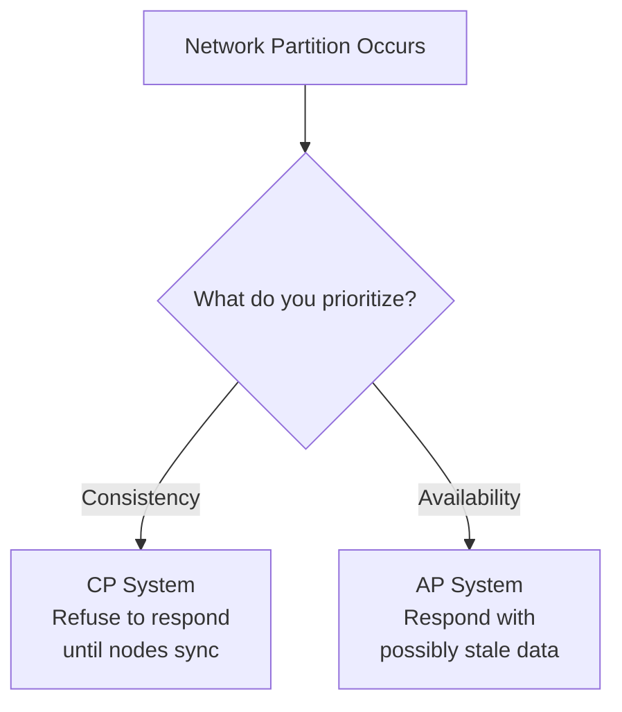
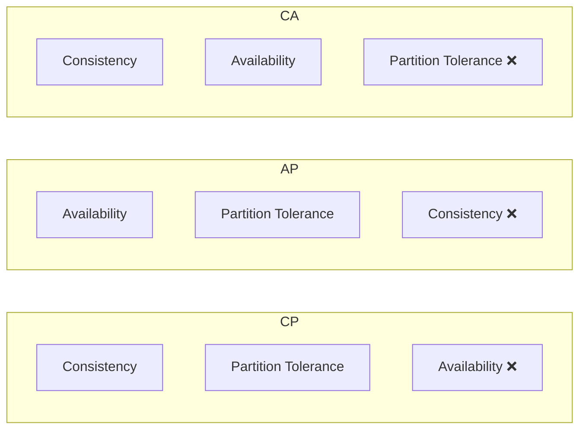

# Video 06 — CAP Theorem

> **Topic:** The CAP theorem — a fundamental concept in distributed systems that defines the trade-off between Consistency, Availability, and Partition Tolerance.

---

## Table of Contents

- [What is the CAP Theorem?](#what-is-the-cap-theorem)
- [The Three Attributes](#the-three-attributes)
- [Partition Tolerance — Why it is Non-Negotiable](#partition-tolerance--why-it-is-non-negotiable)
- [The Core Trade-off](#the-core-trade-off)
- [CAP Categories — CP, AP, CA](#cap-categories--cp-ap-ca)
- [Choosing Between CP and AP](#choosing-between-cp-and-ap)
- [CAP vs Latency — The Deeper Connection](#cap-vs-latency--the-deeper-connection)
- [Quorums & Consensus](#quorums--consensus)
- [Key Takeaways](#key-takeaways)

---

## What is the CAP Theorem?

The CAP theorem states that a distributed database system **cannot simultaneously guarantee all three** of the following properties:

- **C** — Consistency
- **A** — Availability
- **P** — Partition Tolerance

In the event of a network partition, the system is **forced to choose** between consistency and availability.

---

## The Three Attributes

| Attribute | Definition |
|---|---|
| **Consistency (C)** | All nodes see the same up-to-date data at the same time — every read returns the latest write |
| **Availability (A)** | Every request receives a response — even if the data returned is not the most recent |
| **Partition Tolerance (P)** | The system continues operating despite network failures between nodes |

> ⚠️ Note: **Consistency in CAP** is not the same as **Consistency in ACID**. CAP consistency = all nodes return the same data. ACID consistency = database rules and constraints are never violated.

---

## Partition Tolerance — Why it is Non-Negotiable

A **network partition** in CAP theorem means an **unplanned network failure** that causes nodes to lose communication with each other — the data still exists on both nodes but they **cannot sync**.

> ⚠️ This is different from **data partitioning** (sharding) which is an intentional design decision to split data across nodes for scalability.

| | Data Partitioning | Network Partition (CAP) |
|---|---|---|
| **What it is** | Splitting data across nodes | Network failure between nodes |
| **Intentional?** | Yes — design decision | No — failure/accident |
| **Purpose** | Scalability | N/A — it's a problem to handle |
| **Result** | Each node holds a slice of data | Nodes can't communicate or sync |

Network partitions are **inevitable** in any distributed system — hardware fails, cables get cut, data centers lose connectivity. This makes partition tolerance **non-negotiable** in practice.

> 💡 Because P is always required, the real trade-off in CAP is always between **C and A** — not between all three.

---

## The Core Trade-off

When a network partition occurs, the system has two choices:



**CP — during a network partition:**

```
Node 1 ←── network broke ──→ Node 2

Client requests data from Node 2
Node 2 knows it can't confirm its data is up to date
Node 2 refuses to respond → returns error or timeout 
```

> The system says: "I'd rather give you **nothing** than give you **wrong data**."

**AP — during a network partition:**

```
Node 1 ←── network broke ──→ Node 2

Client requests data from Node 2
Node 2 serves whatever data it has — even if stale
Client gets a response  (but possibly outdated)
```

> The system says: "I'd rather give you **something** than give you **nothing**."

> 💡 Once the partition heals and nodes reconnect — CP becomes available again and AP corrects its stale data. The trade-off only exists **during** the partition window.

---

## CAP Categories — CP, AP, CA



| Category | Prioritizes | Sacrifices | Behavior During Partition | Real World? |
|---|---|---|---|---|
| **CP** | Consistency + Partition Tolerance | Availability | Rejects requests until nodes sync | Yes — banking, medical |
| **AP** | Availability + Partition Tolerance | Consistency | Serves stale data until nodes sync | Yes — social media, feeds |
| **CA** | Consistency + Availability | Partition Tolerance | Cannot handle partitions at all | No — theoretical only |

> ⚠️ **CA systems are not viable** for distributed systems — since network partitions are inevitable, a system that cannot tolerate them will simply go down when one occurs. CA only makes sense for single-node or local systems.

---

## Choosing Between CP and AP

The choice depends entirely on **how dangerous stale or wrong data is for your use case**:

| Use Case | Choice | Reason |
|---|---|---|
| Banking / Finance | **CP** | Serving a stale balance could lead to double spending or invalid transactions |
| Medical records | **CP** | Wrong data could directly harm a patient |
| Social media feed | **AP** | Seeing a post that was deleted 2 seconds ago is not a disaster |
| Blogging platform | **AP** | A new post appearing slightly late is acceptable |
| Messaging apps | **AP** | High write/read volume — availability is more important than perfect sync |

### 🤔 Critical Thinking

**Q: In a CP system, how long does the client wait during a partition?**

A: It depends on the system configuration — some return an immediate error, others timeout after a set period. In practice, most CP systems return an error immediately rather than making the client wait indefinitely. The client is then expected to retry once the partition heals. This is why CP systems need good **retry logic and error handling** on the client side.

**Q: If AP systems serve stale data, how do users know the data is stale?**

A: They usually don't — and that's by design for AP use cases. The system is designed around the assumption that brief inconsistency is acceptable. Once the partition heals, all nodes sync and stale data is corrected automatically. This is **eventual consistency** in action.

---

## CAP vs Latency — The Deeper Connection

The CAP theorem is essentially the **extreme version** of the consistency vs latency trade-off:

```
Network working fine       Network slow / laggy       Network partition
        ↓                          ↓                         ↓
Nodes sync fast            Nodes sync with delay      Nodes can't sync at all
Small staleness window     Larger staleness window    Indefinite staleness
```

The real underlying question is always:

> "How long does it take for a write on Node 1 to reach Node 2?"

| Model | Behaviour | Trade-off |
|---|---|---|
| **Strong Consistency** | Wait for all nodes to confirm sync before responding | Higher latency, always correct |
| **Eventual Consistency** | Respond immediately, nodes sync in background | Lower latency, temporarily stale |
| **Network Partition** | Sync delay becomes infinite | Forced hard choice — CP or AP |

> 💡 A network partition is just **latency taken to the extreme**. CAP theorem is really about the consistency vs latency trade-off — a partition just makes the choice unavoidable and permanent until the network recovers.

---

## Quorums & Consensus

Advanced systems don't always make a hard binary CP or AP choice — they use **quorums** to strike a balance.

A quorum defines the **minimum number of nodes** that must acknowledge a read or write before it is considered successful:

```
3 node cluster:

Write quorum = 2 → at least 2 nodes must confirm the write
Read quorum  = 2 → at least 2 nodes must agree on the read value

If 2 out of 3 nodes agree → the system can serve consistent data
even if 1 node is partitioned
```

> 💡 By tuning quorum sizes, a system can dial between stronger consistency and higher availability without making a hard binary choice. This is the basis of **consensus algorithms** like Raft and Paxos used in distributed databases.

---

## Key Takeaways

- The CAP theorem states a distributed system can only guarantee **two of three**: Consistency, Availability, Partition Tolerance.
- **Partition Tolerance is non-negotiable** in distributed systems — network failures are inevitable.
- The real trade-off is always between **Consistency (CP) and Availability (AP)** during a partition.
- **CP** = refuse to serve stale data → return error until nodes sync. Used in banking, medical systems.
- **AP** = serve stale data → correct once partition heals. Used in social media, messaging, blogs.
- **CA** is theoretical only — not viable for real distributed systems.
- CAP is the **extreme version** of the consistency vs latency trade-off — a network partition is just infinite latency.
- **Quorums** allow systems to tune between CP and AP without making a hard binary choice.
