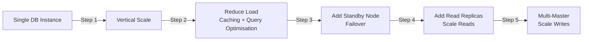
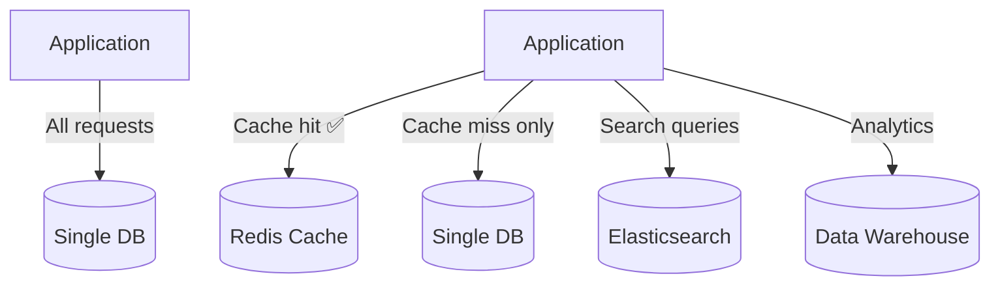
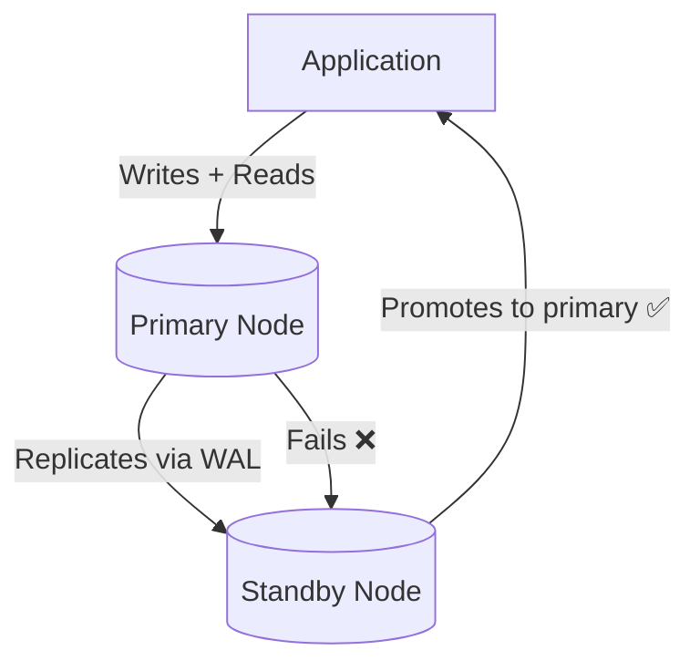
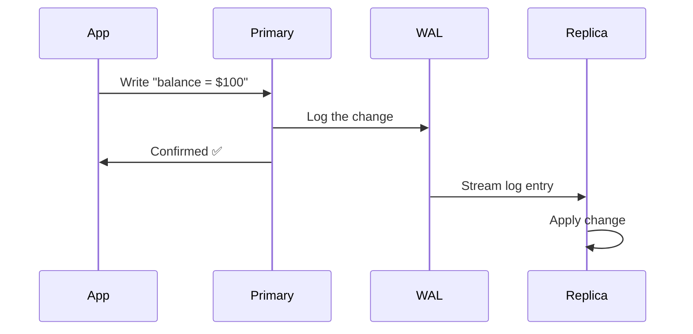
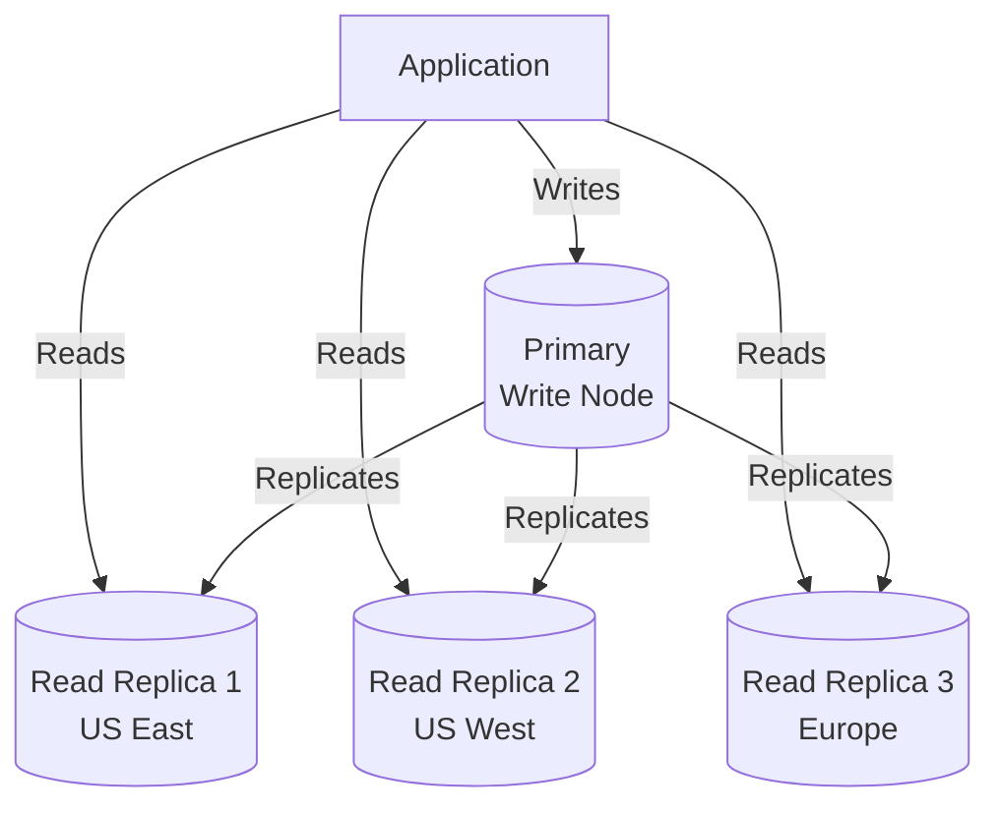
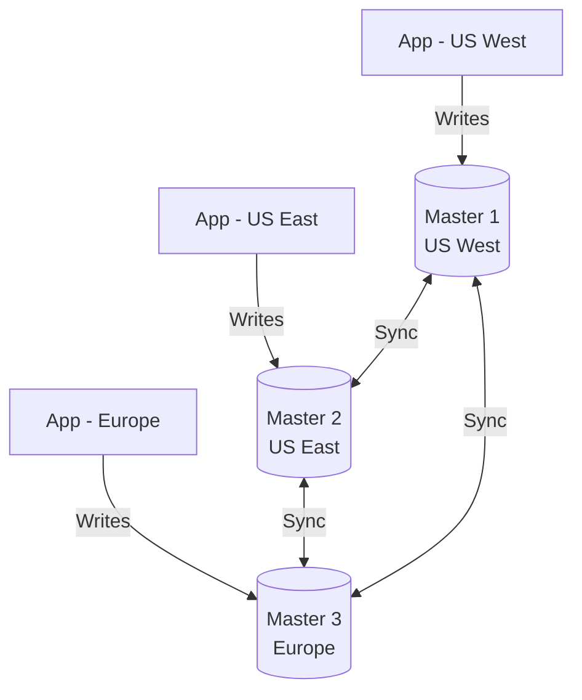
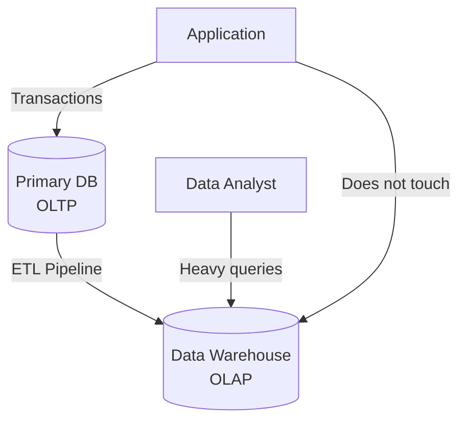
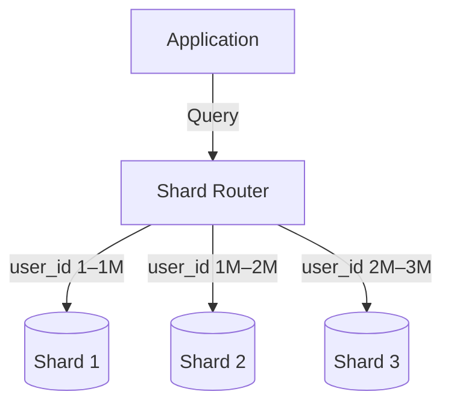

# Video 07 — Database Replication & Sharding

> **Topic:** Transitioning from a single database instance to a cluster — covering replication, multi-master setups, read replicas, consistency models, and an introduction to sharding.

---

## Table of Contents

- [The Goal — From Single Instance to Cluster](#the-goal--from-single-instance-to-cluster)
- [Step 1 — Vertical Scaling First](#step-1--vertical-scaling-first)
- [Step 2 — Reduce Load Before Scaling Out](#step-2--reduce-load-before-scaling-out)
- [Step 3 — High Availability via Replication](#step-3--high-availability-via-replication)
- [How Replication Works — Write-Ahead Log](#how-replication-works--write-ahead-log)
- [Replication Does Not Scale Writes](#replication-does-not-scale-writes)
- [Step 4 — Read Replicas](#step-4--read-replicas)
- [Step 5 — Multi-Master for Write Scaling](#step-5--multi-master-for-write-scaling)
- [Consistency Models in Replication](#consistency-models-in-replication)
- [Load Balancing Reads](#load-balancing-reads)
- [OLTP vs OLAP — Separating Workloads](#oltp-vs-olap--separating-workloads)
- [Sharding — Introduction](#sharding--introduction)
- [Key Takeaways](#key-takeaways)

---

## The Goal — From Single Instance to Cluster

A **cluster** is multiple database instances cooperating to behave as a single system — providing higher availability, better performance, and more capacity than any single node could alone.



> 💡 This progression is deliberate — each step adds complexity. Only move to the next step when the current one is no longer sufficient.

---

## Step 1 — Vertical Scaling First

Before adding more nodes, squeeze as much as possible out of a **single high-powered server**:

- Upgrade CPU, RAM, and storage
- Relational databases are optimised for single-node operation — vertical scaling is simpler and sufficient for many applications
- Use **high-powered servers** rather than commodity hardware for DB workloads

> 💡 Vertical scaling is always the first move for relational databases — distributed data consistency makes horizontal scaling complex and should be deferred as long as possible.

---

## Step 2 — Reduce Load Before Scaling Out

Before adding more DB nodes, reduce the load on the existing instance:



### Tools for offloading DB load

| Tool | Type | Purpose |
|---|---|---|
| **Redis** | In-memory cache | Stores frequently read data — reduces repetitive DB queries |
| **Elasticsearch** | Search engine | Handles full-text search queries — offloads complex search from main DB |
| **IndexedDB** | Client-side DB | Browser-based local storage — stores data that doesn't need server persistence (game state, settings) |
| **Data Warehouse** | Analytical DB | Handles heavy analytical queries — separates OLTP from OLAP workloads |

> 💡 Redis and Elasticsearch are NoSQL databases — but they are used **alongside** the main relational DB for specific purposes, not as replacements.

---

## Step 3 — High Availability via Replication

Once vertical scaling and load reduction are maxed out, add a **standby node** to eliminate the single point of failure.



- The standby node holds an **exact copy** of the primary at all times
- If the primary fails → standby **promotes itself** to primary automatically
- The application reconnects to the new primary with minimal downtime

> ⚠️ The standby node is **passive** — it does not serve reads or writes during normal operation. It exists purely for failover.

---

## How Replication Works — Write-Ahead Log

Replication uses the database's **Write-Ahead Log (WAL)** — a record of every change made to the database, written before the change is applied.

```
Every write operation:
1. Write the change to the WAL first
2. Apply the change to the database
3. Stream the WAL entry to the replica
4. Replica applies the same change
→ Both nodes stay in sync
```



> 💡 The WAL is also used for **crash recovery** — if the primary crashes before applying a change, it can replay the WAL on restart to recover to a consistent state.

---

## Replication Does Not Scale Writes

This is a critical and often misunderstood point:

```
Without replication:
Write → Primary only (1 write operation)

With replication:
Write → Primary + Replica (2 write operations)
```

Adding replicas **doubles the total number of writes** in the system — it does not reduce write load, it increases it. Replication improves:
- ✅ **Availability** — failover if primary goes down
- ✅ **Read capacity** — replicas can serve reads
- ❌ **Write throughput** — NOT improved, actually increases total write work

> ⚠️ If your bottleneck is write throughput, replication alone will not solve it. You need multi-master or sharding.

### 🤔 Critical Thinking

**Q: If replication increases total writes, why do we still do it?**

A: Because the goal of replication is not to reduce writes — it is to ensure **durability and availability**. Having two copies of your data means you don't lose everything if one node fails. The extra write cost is the price you pay for that safety guarantee. Write throughput is a separate problem solved by multi-master or sharding.

---

## Step 4 — Read Replicas

Add **dedicated read-only nodes** that serve all read queries — leaving the primary node free to handle writes only.



- Read replicas can be **geographically distributed** — users in each region read from the nearest replica
- Reads and writes can be **independently scaled** — add more read replicas without touching the primary
- If a read replica fails → redirect reads to another replica (less critical than primary failure)

> 💡 This is the most common first step for scaling a read-heavy relational database — one write node + multiple geographically distributed read replicas.

---

## Step 5 — Multi-Master for Write Scaling

When write load exceeds what a single primary can handle, introduce **multiple active write nodes**.



- Each master accepts writes for its region — reducing cross-region write latency
- Masters replicate to each other to stay in sync
- Write conflicts are possible — resolved via LWW, Vector Clocks, CRDTs, 2PC, or Quorum writes

| Benefit | Challenge |
|---|---|
| Increased write throughput | Write conflict resolution complexity |
| Reduced write latency per region | Harder to maintain consistency |
| Higher durability via redundancy | Enterprise-level complexity |

> ⚠️ Multi-master is complex and should only be adopted when write load genuinely demands it. Most applications never need it.

---

## Consistency Models in Replication

| Model | How it works | Trade-off |
|---|---|---|
| **Eventual Consistency** | Primary confirms write immediately — replicas sync asynchronously | Fast writes, temporarily stale reads |
| **Strong Consistency** | Write waits for all replicas to confirm before responding | Always fresh reads, slower writes |

```
Eventual Consistency (default for most systems):
App writes post → Primary confirmed ✅
Read Replica syncs 200ms later
User reads from replica → may not see the new post yet ⚠️

Strong Consistency:
App writes post → waits for all replicas to confirm
All replicas updated → Primary confirmed ✅
User reads from any replica → always sees the new post ✅
```

> 💡 Eventual consistency is acceptable for most applications — social media, blogs, general CRUD apps. Strong consistency is required for financial systems and medical records where stale data causes real harm.

---

## Load Balancing Reads

With multiple read replicas, incoming read queries need to be distributed efficiently:

| Approach | Description |
|---|---|
| **HAProxy** | Dedicated load balancer for DB connections — routes reads across replicas |
| **Weighted DNS routing** | DNS-level routing — send more traffic to larger replicas |
| **Round-robin in app code** | Application cycles through connection strings for each read |
| **Amazon Aurora** | Managed PostgreSQL-compatible DB with **built-in read load balancing** |

> 💡 For most teams, a managed service like **Amazon Aurora** is the practical choice — it handles read load balancing, replication, and failover automatically without manual configuration.

---

## OLTP vs OLAP — Separating Workloads

A major technique for reducing load on the primary database is separating **transactional** and **analytical** workloads onto different systems.

| | OLTP | OLAP |
|---|---|---|
| **Full name** | Online Transaction Processing | Online Analytical Processing |
| **Purpose** | Day-to-day transactions | Complex analytical queries |
| **Operations** | INSERT, UPDATE, DELETE | Aggregations, joins, reports |
| **Data volume** | Current, live data | Historical, large datasets |
| **Example** | User places an order | Monthly revenue report across all orders |
| **System** | Relational DB (PostgreSQL) | Data Warehouse (BigQuery, Redshift, Snowflake) |



> 💡 Running heavy analytical queries on your primary transactional database is a common performance killer. A data warehouse offloads this entirely — your primary DB stays fast for user-facing transactions while analysts run complex reports separately.

### 🤔 Critical Thinking

**Q: Why can't you just run analytics on a read replica instead of a separate data warehouse?**

A: You can — and many small teams do this as a first step. But read replicas hold **live transactional data** and are still connected to the replication stream, meaning heavy analytical queries compete with user-facing reads and can slow the replica down. A data warehouse is purpose-built for analytical queries — it uses **columnar storage** optimised for aggregations and large scans, whereas relational DBs use row storage optimised for individual record lookups. For serious analytics at scale, a dedicated data warehouse is the right tool.

---

## Sharding — Introduction

**Sharding** splits data horizontally across multiple nodes — unlike replication where every node holds a full copy, each shard holds a **distinct subset** of the data.



| | Replication | Sharding |
|---|---|---|
| **Data distribution** | Full copy on every node | Subset on each node |
| **Purpose** | Availability + read scaling | Write scaling + storage scaling |
| **Query routing** | Any node can answer any query | Router must direct query to correct shard |
| **Complexity** | Medium | High |

> ⚠️ Sharding complicates write logic and data retrieval — data is no longer fully duplicated so queries must be routed carefully. Sharding is covered in depth in future lessons, especially in the context of NoSQL databases which are designed with sharding in mind from the start.

---

## Key Takeaways

- Always **vertical scale first** for relational databases — it is simpler and sufficient for most applications.
- **Reduce load** before adding nodes — Redis for caching, Elasticsearch for search, data warehouse for analytics.
- **Replication** improves availability and read capacity — it does NOT improve write throughput.
- The **WAL (Write-Ahead Log)** is the mechanism that powers replication — every change is logged and streamed to replicas.
- **Read replicas** are the most practical first step for scaling reads — distribute them geographically for latency reduction.
- **Multi-master** scales writes but introduces write conflict complexity — adopt only when genuinely needed.
- **Eventual consistency** is the default for most replicated systems — strong consistency is slower but necessary for critical data.
- **OLTP** (transactions) and **OLAP** (analytics) should be separated — run analytics on a data warehouse, not the primary DB.
- **Sharding** partitions data across nodes — unlike replication it does not duplicate data, each node holds a unique slice.
