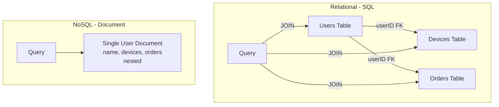
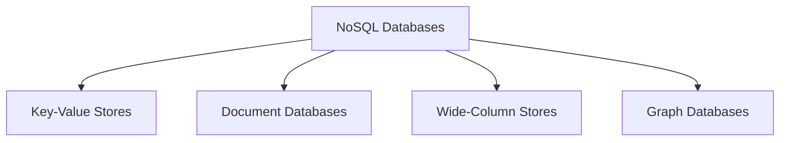
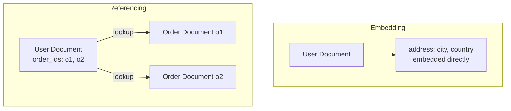
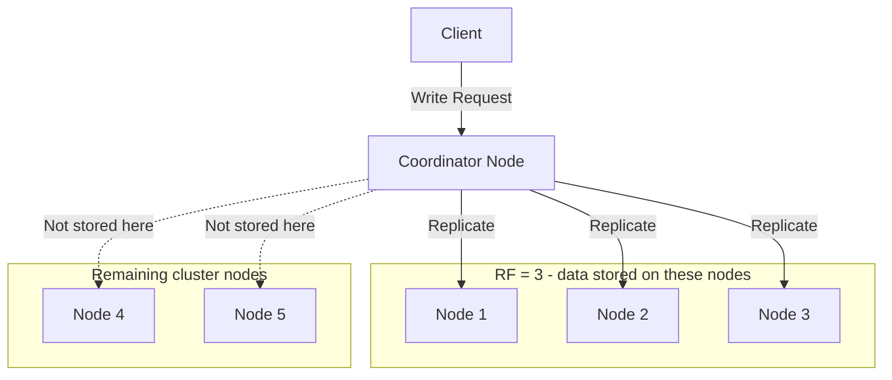
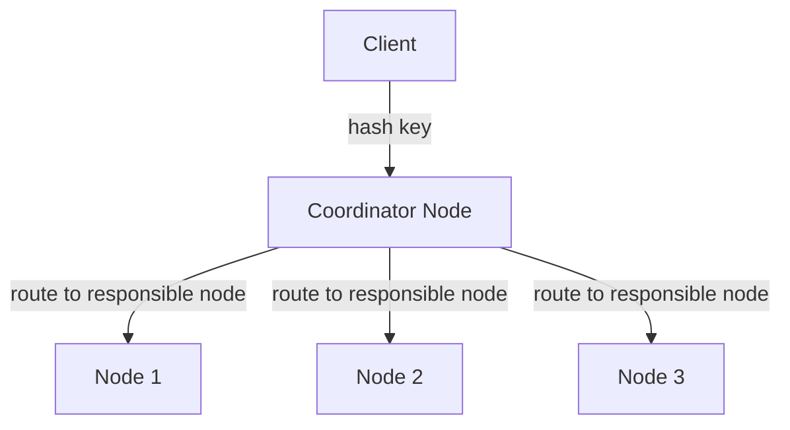
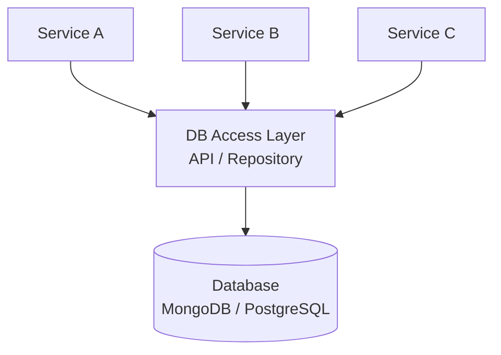

# Video 08 — Introduction to NoSQL Databases

> **Topic:** A comprehensive introduction to NoSQL databases — data modeling, types, schema flexibility, consistency, and distributed design principles, with a focus on MongoDB as the primary document database example.

---

## Table of Contents

- [SQL vs NoSQL — The Core Difference](#sql-vs-nosql--the-core-difference)
- [The Aggregate Concept — Access Together Store Together](#the-aggregate-concept--access-together-store-together)
- [Schema Flexibility](#schema-flexibility)
- [Query-Driven Data Modeling](#query-driven-data-modeling)
- [Types of NoSQL Databases](#types-of-nosql-databases)
- [Document Databases — MongoDB Deep Dive](#document-databases--mongodb-deep-dive)
- [Replication Factor & Quorum Consensus](#replication-factor--quorum-consensus)
- [Consistent Hashing](#consistent-hashing)
- [ID Generation in Distributed Systems](#id-generation-in-distributed-systems)
- [DB Abstraction Layer](#db-abstraction-layer)
- [Key Takeaways](#key-takeaways)

---

## SQL vs NoSQL — The Core Difference

Relational databases store data in **tables with rows and columns** — related data is split across multiple tables and joined at query time.

NoSQL databases store related data **together in a single structure** — no joins needed, data is retrieved in one operation.



| Aspect | Relational SQL | NoSQL |
|---|---|---|
| **Data structure** | Tables, rows, columns | Documents, key-value, graphs, wide-column |
| **Related data** | Split across tables, joined at query time | Nested together in one structure |
| **Schema** | Strict, enforced | Flexible, dynamic |
| **Scaling** | Vertical first, horizontal complex | Built for horizontal scaling |
| **Query flexibility** | High — ad hoc queries, complex joins | Limited — query patterns must be planned |
| **Best for** | Complex queries, strong consistency | Scale, speed, flexible data models |

---

## The Aggregate Concept — Access Together Store Together

An **aggregate** is a logical unit of data that is stored and accessed as a single atomic unit.

> 💡 The core NoSQL design principle: **"Data that is accessed together should be stored together."**

**Relational approach — data split across tables:**

```
Users table      → user_id, name, email
Devices table    → device_id, user_id, device_name
Orders table     → order_id, user_id, total

Query to get full user profile = 3 table JOINs
```

**NoSQL approach — data nested in one document:**

```json
{
  "user_id": "123",
  "name": "Reyad",
  "email": "r@gmail.com",
  "devices": [
    { "device_id": "d1", "name": "iPhone" },
    { "device_id": "d2", "name": "MacBook" }
  ],
  "orders": [
    { "order_id": "o1", "total": 150 }
  ]
}
```

Query to get full user profile = **single document fetch, no joins**.

> ⚠️ This works well when you always access the data together. If you need to query devices independently of users, storing them nested becomes a problem — you'd have to scan all user documents to find a specific device.

### 🤔 Critical Thinking

**Q: If storing data together is so efficient, why don't relational databases do it?**

A: Relational databases were designed around **normalisation** — eliminating data redundancy and ensuring consistency. If a user's email appears in 1000 nested documents and they change it, you'd need to update 1000 places. In a relational DB you update one row in one table. NoSQL trades normalisation for **read performance and scalability** — the right choice depends on whether your workload is read-heavy or update-heavy.

---

## Schema Flexibility

NoSQL databases are **schema-less or schema-flexible** — different records can have completely different attributes.

```
Relational — all rows must have the same columns:
| user_id | name  | email         | phone |
|---------|-------|---------------|-------|
| 1       | Reyad | r@gmail.com   | NULL  |  ← phone must exist, even if empty
| 2       | Ahmed | a@gmail.com   | NULL  |

NoSQL — each document can have different fields:
{ "user_id": 1, "name": "Reyad", "email": "r@gmail.com" }
{ "user_id": 2, "name": "Ahmed", "phone": "01234567890" }  ← email simply absent
```

| Aspect | Relational SQL | NoSQL Schema-less |
|---|---|---|
| **Schema changes** | Requires migrations — can be expensive | Add new fields instantly, no migration |
| **Missing data** | NULL or default value | Field simply omitted |
| **Development speed** | Slower — schema must be defined upfront | Faster prototyping |
| **Data validation** | Enforced by DB | Enforced by application code |
| **Risk** | Less runtime errors | Inconsistent data if app doesn't validate |

> 💡 Some relational databases (including PostgreSQL) now support **JSON columns** — a hybrid approach offering some schema flexibility without fully switching to NoSQL.

> ⚠️ Schema-less shifts complexity to the **application layer** — your code must handle variable data structures. This can cause runtime errors if not carefully managed.

---

## Query-Driven Data Modeling

Unlike relational databases where you design the schema and then write queries, NoSQL requires you to **design your data model around your queries**.

```
Relational approach:
1. Design normalised schema
2. Write any query you want — DB handles it

NoSQL approach:
1. Define your access patterns first — what queries will you run?
2. Design data model to make those queries efficient
3. Other query patterns may be slow or impossible
```

> ⚠️ NoSQL databases generally **do not support complex multi-table joins or ad hoc queries**. If you don't plan your access patterns upfront, you'll end up with slow queries or full collection scans.

---

## Types of NoSQL Databases



| Type | How data is stored | Best for | Examples |
|---|---|---|---|
| **Key-Value** | Key maps to a value (opaque blob) | Caching, session storage, simple lookups | Redis, DynamoDB |
| **Document** | Key maps to a structured JSON-like document | Nested data, flexible schemas, general purpose | MongoDB, CouchDB |
| **Wide-Column** | Rows with dynamic columns — each row can have different columns | Large-scale distributed storage, time-series | Cassandra, Google Bigtable |
| **Graph** | Nodes connected by edges | Social networks, recommendation engines, fraud detection | Neo4j |

### Key-Value — How it works

Uses a **hash function** to map keys to storage locations — constant time O(1) read/write.

```
hash("user:123") → storage location → value (opaque blob)
```

The value is treated as a single atomic unit — the DB has no awareness of what's inside it. The application is responsible for serialising and deserialising the value.

> 💡 Redis is the most common key-value store — used as an in-memory cache layer between the application and the main database.

### Wide-Column — How it differs from relational

```
Relational — fixed columns, all rows same structure:
| user_id | name  | email       |
|---------|-------|-------------|
| 1       | Reyad | r@gmail.com |
| 2       | Ahmed | a@gmail.com |

Wide-Column — dynamic columns per row:
Row 1: { user_id: 1, name: "Reyad", email: "r@gmail.com", verified: true }
Row 2: { user_id: 2, name: "Ahmed", phone: "01234" }  ← different columns
```

> 💡 Cassandra is the most widely used wide-column store — designed for massive horizontal scaling across thousands of nodes.

---

## Document Databases — MongoDB Deep Dive

MongoDB is the most popular document database — it stores data as **BSON documents** (Binary JSON) organised into **collections**.

### Core Concepts

| MongoDB | Relational Equivalent |
|---|---|
| **Database** | Database |
| **Collection** | Table |
| **Document** | Row |
| **Field** | Column |
| **Embedded document** | JOIN result |
| **_id** | Primary Key |

### Document Structure

```json
{
  "_id": "ObjectId('64a7f2c1e4b0d3a1c8e9f123')",
  "name": "Reyad",
  "email": "r@gmail.com",
  "address": {
    "city": "Giza",
    "country": "Egypt"
  },
  "orders": [
    { "order_id": "o1", "total": 150, "status": "delivered" },
    { "order_id": "o2", "total": 200, "status": "pending" }
  ]
}
```

### Embedding vs Referencing

One of the key design decisions in MongoDB — should related data be **embedded** (nested) or **referenced** (like a foreign key)?

| | Embedding | Referencing |
|---|---|---|
| **How** | Nest the related data inside the document | Store the ID and look up separately |
| **Read performance** | Fast — single document fetch | Slower — multiple queries needed |
| **Write performance** | Slower if nested data changes often | Faster — update one document |
| **Best for** | Data always accessed together, rarely updated | Data accessed independently, frequently updated |
| **Example** | User with their address | User with their orders (if orders are queried independently) |



> 💡 A common rule of thumb in MongoDB: **embed when you always need the data together, reference when the related data is large, frequently updated, or queried independently.**

### Indexing in MongoDB

Without an index, MongoDB performs a **full collection scan** — reads every document to find matches. With an index it jumps directly to the matching documents.

```
Without index:
db.users.find({ email: "r@gmail.com" })
→ scans ALL documents in collection 🐢

With index on email:
db.users.find({ email: "r@gmail.com" })
→ jumps directly to matching document ⚡
```

> ⚠️ Indexes speed up reads but **slow down writes** — every write must also update the index. Create indexes only for fields you actually query on.

### 🤔 Critical Thinking

**Q: When should you choose MongoDB over PostgreSQL?**

A: MongoDB is a better fit when your data is naturally hierarchical or nested, your schema evolves frequently, or you need to scale horizontally with ease. PostgreSQL is better when you need complex queries across many related entities, strong ACID transactions, or strict data integrity. In practice many systems use both — PostgreSQL as the main transactional store and MongoDB for specific domains with flexible or nested data.

---

## Replication Factor & Quorum Consensus

NoSQL clusters replicate data across multiple nodes for reliability. Three key parameters control this:

| Parameter | Meaning | Example |
|---|---|---|
| **RF (Replication Factor)** | Number of nodes data is copied to | RF=3 → data stored on 3 nodes |
| **W (Write Quorum)** | Nodes that must confirm a write | W=2 → 2 nodes must confirm before success |
| **R (Read Quorum)** | Nodes that must agree on a read | R=2 → read from 2 nodes and compare |



- **W = 2** — nodes 1 and 2 must confirm the write before success
- **R = 2** — nodes 2 and 3 must agree on the read value
- **W + R = 4 > RF = 3** → Strong Consistency guaranteed ✅

### The Consistency Formula

```
W + R > RF → Strong Consistency guaranteed
W + R ≤ RF → Eventual Consistency (faster but possibly stale)
```

> 💡 When W + R > RF, at least one node is guaranteed to have participated in both the last write and the current read — meaning you always get the latest data. Lowering W or R below this threshold trades consistency for lower latency.


## Consistent Hashing

NoSQL clusters use **consistent hashing** to distribute data across nodes — mapping data keys to positions on a virtual ring.



- Each key is hashed to a point on the ring
- The node responsible for that point stores the data
- When nodes are added or removed, only a small portion of keys need to be remapped

> 💡 Consistent hashing minimises data movement when the cluster scales — unlike naive modulo hashing where adding one node would require redistributing almost all data.

---

## ID Generation in Distributed Systems

Relational databases use **autoincrement IDs** — a single node generates sequential IDs easily. In distributed NoSQL systems, multiple nodes accept writes simultaneously, making sequential ID generation impossible without coordination.

### Solutions

| Strategy | How it works | Pros | Cons |
|---|---|---|---|
| **Centralised ID generator** | Dedicated server generates IDs | Sequential, simple | Single point of failure |
| **Natural keys** | Use existing unique data as key (e.g. email, username) | No generation needed | Not always available |
| **UUID / GUID** | 128-bit randomly generated ID | Guaranteed unique, no coordination | Large size, no natural ordering |
| **Snowflake ID** | 64-bit ID encoding timestamp + node ID + sequence | Unique, sortable by time, compact | Requires clock synchronisation |

### Snowflake ID Structure

```
| 41 bits timestamp | 10 bits node ID | 12 bits sequence |
```

- **Timestamp** — milliseconds since epoch — makes IDs naturally sortable by creation time
- **Node ID** — identifies which server generated the ID — prevents collisions across nodes
- **Sequence** — handles multiple IDs generated in the same millisecond on the same node

> 💡 Discord uses Snowflake IDs for messages — the message ID encodes when it was sent, enabling efficient time-range queries without a separate timestamp field.

---

## DB Abstraction Layer

A key architectural recommendation: **wrap all database access behind an API or SDK layer** rather than letting services call the database directly.



- Services interact with a consistent interface — not with DB-specific drivers
- If you switch from MongoDB to PostgreSQL (or vice versa), only the DB access layer changes
- Prevents DB-specific code from spreading across multiple services

> 💡 In .NET / C# this is typically implemented as the **Repository Pattern** — each entity has a repository class that encapsulates all DB operations. Services call the repository, never the DB directly.

---

## Key Takeaways

- **NoSQL** is not one thing — it is a category of databases each optimised for specific use cases: Key-Value, Document, Wide-Column, Graph.
- The core NoSQL principle: **access together, store together** — aggregate related data in one structure to avoid joins.
- **Schema flexibility** speeds up development but shifts data validation responsibility to the application.
- **Query-driven modeling** is essential in NoSQL — design your data model around your access patterns, not the other way around.
- **MongoDB** stores data as nested JSON-like documents — embed for data always accessed together, reference for data accessed independently.
- The **W + R > RF** formula controls the consistency vs latency trade-off in NoSQL clusters.
- **Consistent hashing** distributes data across nodes efficiently — minimises reshuffling when cluster size changes.
- **Snowflake IDs** solve the distributed ID generation problem — unique, sortable, and coordination-free.
- Always wrap DB access behind an **abstraction layer** — decouples services from DB-specific implementation details.
