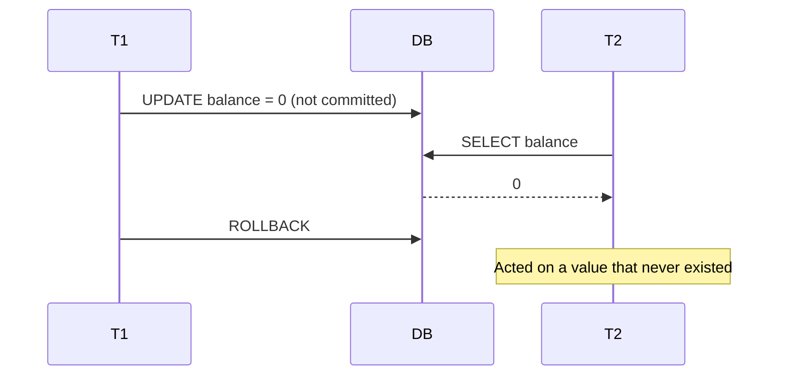
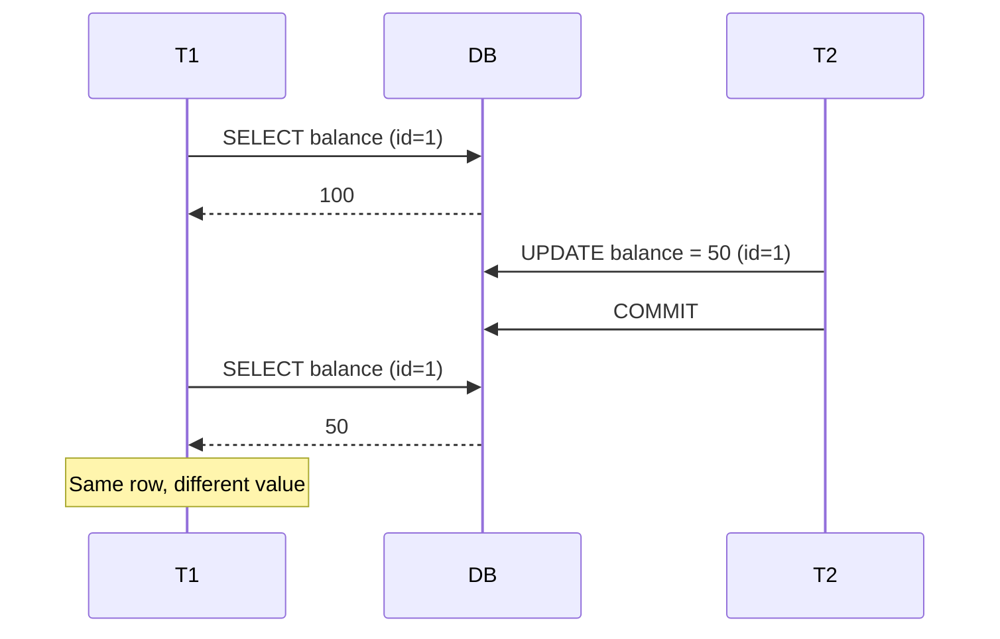
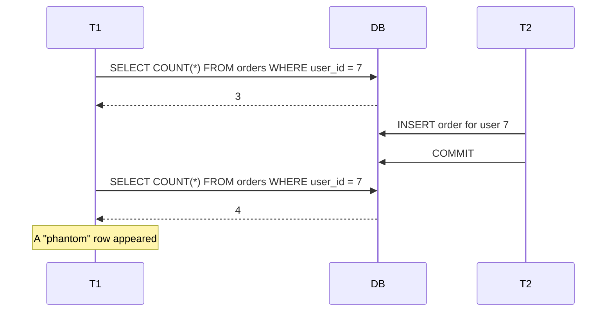
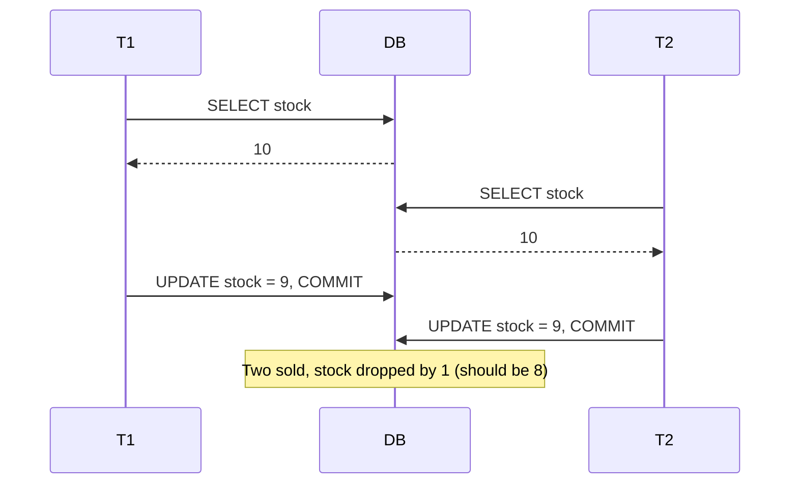
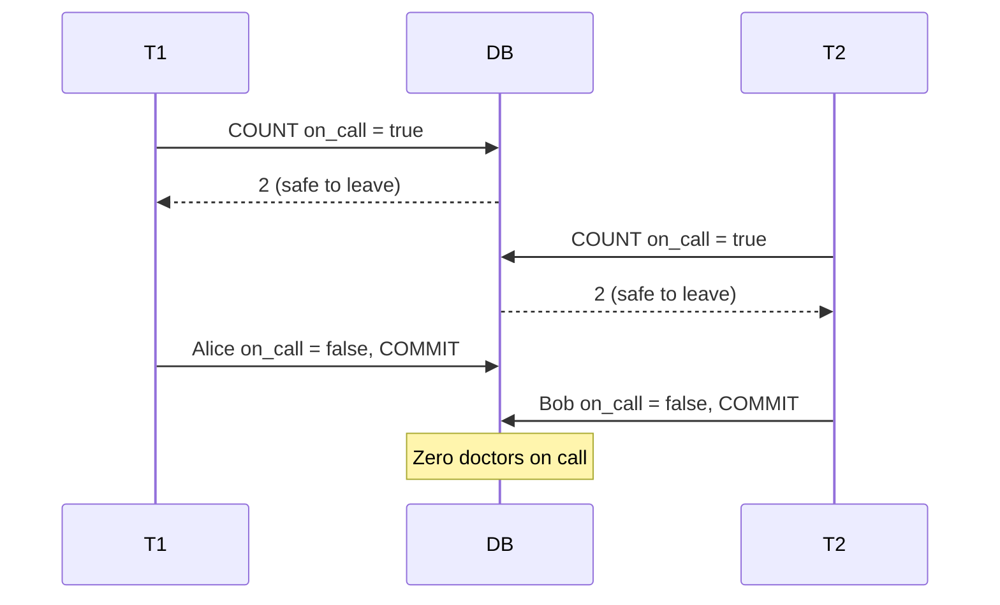
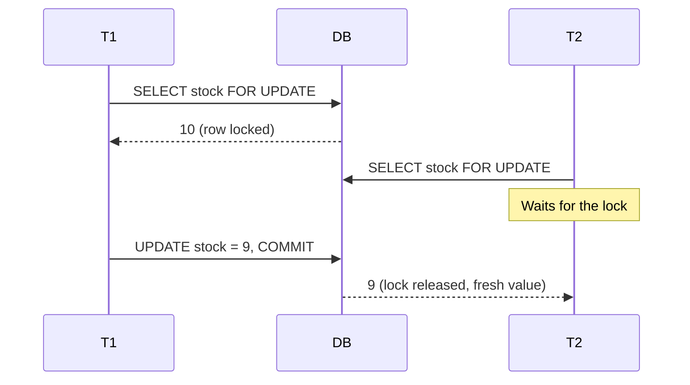

# Transaction Isolation Levels

## Table of Contents

- [Why isolation levels exist](#why-isolation-levels-exist)
- [The anomalies](#the-anomalies)
- [Isolation levels vs anomalies](#isolation-levels-vs-anomalies)
- [Choosing a level](#choosing-a-level)
- [Cost of Serializable](#cost-of-serializable)
- [Interview summary](#interview-summary)

---

## Why isolation levels exist

Transactions run concurrently. Perfect isolation (as if they ran one after another) is expensive, so databases let you **trade correctness for throughput** by choosing a weaker level.

> Higher isolation = fewer anomalies, but lower concurrency and more aborts/retries.

---

## The anomalies

Setup: tables `accounts`, `orders`, `products`, `doctors`. Two transactions, **T1** and **T2**, run at the same time.

### 1. Dirty read

Reading data another transaction wrote but has not committed.



### 2. Non-repeatable read

Reading the **same row twice** in one transaction and getting **different values**.



### 3. Phantom read

Running the **same query twice** and getting **different rows**. Existing rows did not change; a new row now matches.



**Non-repeatable vs phantom:** non-repeatable = a row you already read **changed**. Phantom = the **set of rows** matching your query changed.

### 4. Lost update

Both transactions read the same value, both write, one overwrites the other.



### 5. Write skew

Two transactions read the **same data**, then update **different rows**, and together break a rule. No row-level conflict exists, so the DB does not notice.

Rule: *at least one doctor must be on call.* Alice and Bob are both on call.



### Mental shortcut

| Group | Anomalies | Meaning |
|---|---|---|
| Single row changes under you | Dirty read, non-repeatable read | Reads are unstable |
| Set of rows changes under you | Phantom read | Query results are unstable |
| Writes based on stale reads | Lost update, write skew | Decisions made on outdated data |

---

## Isolation levels vs anomalies

| Level | Dirty read | Non-repeatable read | Phantom | Lost update | Write skew |
|---|---|---|---|---|---|
| Read Uncommitted | possible | possible | possible | possible | possible |
| Read Committed | prevented | possible | possible | possible | possible |
| Repeatable Read | prevented | prevented | engine-dependent | engine-dependent | possible (Postgres) |
| Serializable | prevented | prevented | prevented | prevented | prevented |

---

## Choosing a level

| Level | Typical use |
|---|---|
| **Read Committed** | Default for most OLTP: product listings, general CRUD |
| **Repeatable Read** | Multi-step logic that reads the same data several times, reports needing a consistent snapshot |
| **Serializable** | Multi-row invariants that cannot be enforced otherwise (e.g. "total across accounts must stay >= 0", on-call rules) |

### Don't reach for a higher level first

For **single-row read-modify-write** (e.g. checkout stock), fix the write, not the isolation level. All three options below solve the **lost update** problem (two buyers read `stock = 10`, both write `9`, one sale disappears).

#### 1. Atomic update

```sql
UPDATE products SET stock = stock - 1 WHERE id = 1 AND stock > 0;
```

- The database does the read and write in **one statement**, so there is no gap between reading `10` and writing `9`.
- `stock = stock - 1` uses the current value at write time, not a value the app read earlier.
- `AND stock > 0` prevents overselling. If stock is 0, no row matches and **0 rows are affected**; the app checks that count and reports "out of stock".
- Best when the change is a simple calculation.

#### 2. Row lock (pessimistic)

```sql
SELECT stock FROM products WHERE id = 1 FOR UPDATE;
```

- `FOR UPDATE` reads the row **and locks it** until the transaction ends.
- If T2 runs the same `SELECT ... FOR UPDATE`, it **waits** until T1 commits, then reads the fresh value.
- Use it when you need to read, run complex app logic, then write, and one `UPDATE` can't express it.
- Cost: other transactions wait, and deadlocks are possible.



#### 3. Optimistic locking (version column)

```sql
UPDATE products SET stock = 9, version = version + 1
WHERE id = 1 AND version = 5;
```

- No lock is held. When reading the row, you also read its `version` (here, 5).
- When writing, you say "update only if the version is still 5" and bump it to 6.
- If someone else changed the row first, the version is no longer 5, so **0 rows are affected**. That signals a conflict: the app re-reads and retries.
- Best when conflicts are rare (e.g. a user editing their own profile). Under heavy contention you retry a lot.

#### Which one to use

| Situation | Choice |
|---|---|
| Simple change (`stock - 1`, `balance + x`) | Atomic update |
| Read, complex logic, then write, frequent conflicts | Row lock |
| Read, complex logic, then write, rare conflicts | Optimistic locking |

---

## Cost of Serializable

- Lower throughput and more contention.
- In Postgres, transactions can fail with **serialization errors**. The application **must retry**.
- Many financial systems use weaker levels plus explicit locking because of this cost. Use Serializable when you have multi-row invariants you can't enforce another way.

---

## Interview summary

> "I'd default to Read Committed. For read-modify-write on a single row, I'd use atomic updates or row locks rather than raising isolation. For multi-row invariants like write skew, I'd use Serializable and retry on serialization failures."

Always mention:
- Anomalies by name (not just level names)
- Retries when using Serializable
