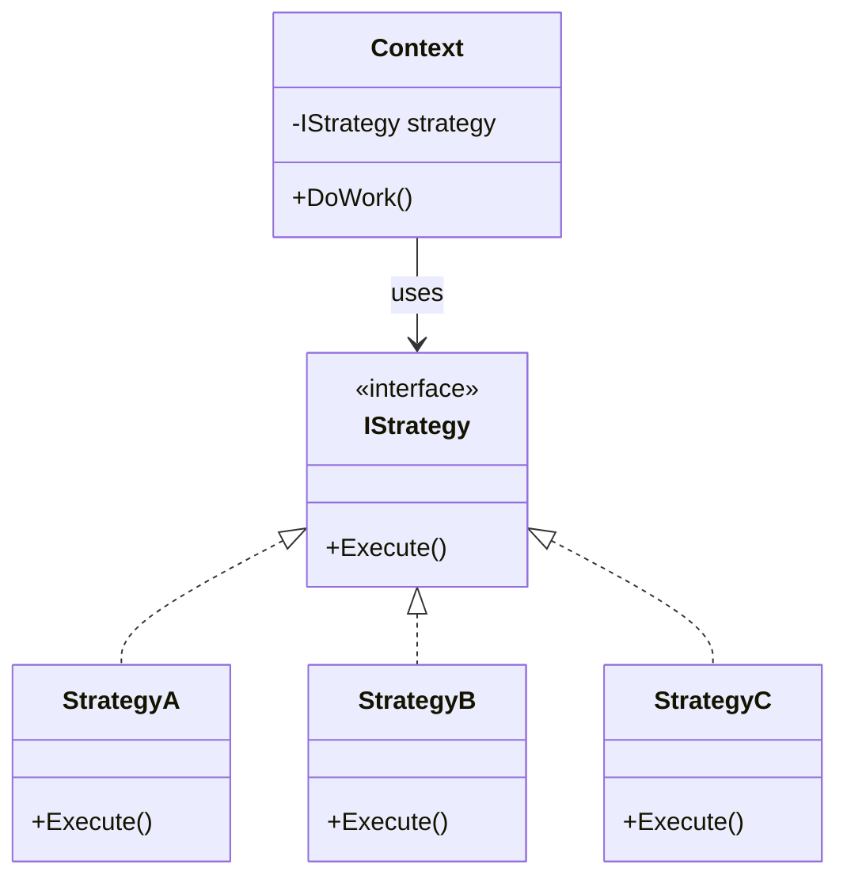
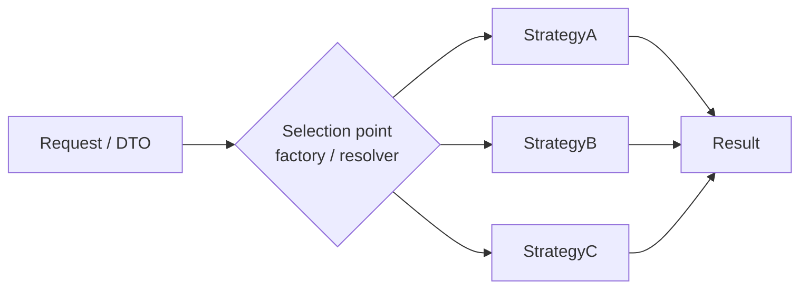
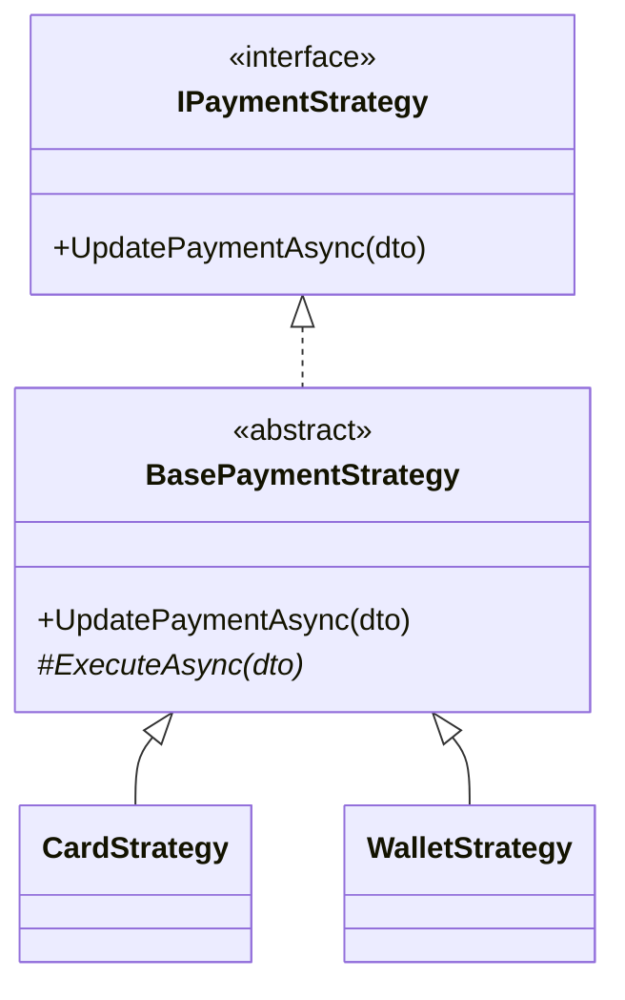

# Strategy Pattern

> **Category:** Behavioral design pattern (GoF) · **Level:** code design (LLD), not system design

## 1. The problem

One job, many ways to do it. For example, "process a payment" works differently for a card, a wallet, and a bank transfer.

The naive solution is one method with a branch per variant:

```csharp
public async Task<bool> UpdatePayment(PaymentDto dto)
{
    if (dto.Type == "Card")        { /* 20 lines of card rules */ }
    else if (dto.Type == "Wallet") { /* 25 lines of wallet rules */ }
    else if (dto.Type == "Bank")   { /* 30 lines of bank rules */ }
    // ... and it grows with every new variant
}
```

Problems with this approach:

- Adding a variant means **editing this method**, which risks breaking the others.
- The method keeps growing and becomes hard to read and test.
- The same `if/else` often gets copied into several places.

## 2. The idea

> Define a **family of algorithms**, put each one in **its own class** behind a **common interface**, and make them **interchangeable**.

The caller depends only on the interface. It doesn't know or care which concrete class it received.

## 3. Structure



| Role | Responsibility |
|---|---|
| **Strategy interface** | The one method the caller is allowed to know about |
| **Concrete strategy** | The rules of one variant |
| **Context** | Uses a strategy without knowing which one it got |

## 4. Minimal example (C#)

```csharp
// Strategy interface
public interface IPaymentStrategy
{
    Task<bool> UpdatePaymentAsync(PaymentDto dto);
}

// Concrete strategies: one class per variant
public class CardStrategy : IPaymentStrategy
{
    public Task<bool> UpdatePaymentAsync(PaymentDto dto) { /* card rules */ }
}

public class WalletStrategy : IPaymentStrategy
{
    public Task<bool> UpdatePaymentAsync(PaymentDto dto) { /* wallet rules */ }
}

// Context: no knowledge of any concrete class
var strategy = factory.GetStrategy(dto);        // picks the strategy
var result   = await strategy.UpdatePaymentAsync(dto);
```

## 5. "But there is still an `if` somewhere"

Yes. Strategy doesn't remove the decision. **It moves it to one place and makes it small.**

| Without Strategy | With Strategy |
|---|---|
| The `if/else` is inside the business logic | The `if/switch` is in **one selection point** |
| Each branch holds the full logic | Each branch only **creates an object** |
| Often repeated in several places | Written once |

A typical selection point is a factory:

```csharp
public static class PaymentStrategyFactory
{
    public static IPaymentStrategy GetStrategy(PaymentDto dto) => dto switch
    {
        CardDto   => new CardStrategy(),
        WalletDto => new WalletStrategy(),
        _ => throw new NotSupportedException($"No strategy for {dto.GetType().Name}")
    };
}
```

Common ways to implement the selection:

| Approach | Notes |
|---|---|
| `switch` in a factory | Simplest. Adding a variant means one new line |
| Dictionary or DI map (payment type → strategy) | No existing line is edited when adding a variant |
| Each strategy exposes `CanHandle(dto)`, the resolver picks the first match | Same benefit, selection logic lives in the strategies |

The input that drives the choice can be an enum, a type, or, as in the reference example below, the **type of the DTO** sent by the client.



## 6. Strategy + Template Method (shared steps)

Often every variant shares some steps (validation, logging, checks) and only one step differs. Repeating the shared steps in every strategy duplicates code.

The fix: put the shared flow in an **abstract base class** (the **Template Method** pattern) and leave only the varying step abstract.

```csharp
public abstract class BasePaymentStrategy : IPaymentStrategy
{
    // Hook: subclasses may override to tweak the shared flow
    protected virtual bool EnforceRateLimit => true;

    // Template method: fixed order of steps
    public async Task<bool> UpdatePaymentAsync(PaymentDto dto)
    {
        ValidateSession(dto);              // shared
        CheckAccountActive(dto);           // shared
        if (EnforceRateLimit)
            ApplyRateLimit(dto);           // shared, unless a subclass opts out
        return await ExecuteAsync(dto);    // varies per strategy
    }

    protected abstract Task<bool> ExecuteAsync(PaymentDto dto);
}

public class CardStrategy : BasePaymentStrategy
{
    protected override Task<bool> ExecuteAsync(PaymentDto dto) { /* card only */ }
}
```



| Part | Pattern |
|---|---|
| Interface with interchangeable implementations, chosen at runtime | **Strategy** |
| Base class owns the fixed flow and shared steps, subclasses fill in what changes | **Template Method** |

> Strictly, pure Strategy uses **composition**. This version adds **inheritance** to avoid duplicating the shared steps. It's a common and practical combination.

The `EnforceRateLimit` property is a **hook**: a subclass can override it to change the shared flow without replacing the whole flow.

## 7. Benefits

- **Open/Closed principle:** adding a variant means adding a class, not editing existing code.
- **No giant `if/else` or `switch`** in the business logic. Polymorphism replaces it.
- **Single responsibility:** each class knows one variant only.
- **Isolated changes and testing:** a change in one variant can't break the others, and each can be unit-tested alone.
- **No duplication:** shared logic lives once (with the Template Method variation).
- **Swappable at runtime:** the right implementation is chosen per request, usually via a factory or DI.

## 8. Trade-offs

- **More classes:** one per variant. This is overkill for two or three simple branches that won't grow.
- **Inheritance coupling** (Template Method variation): all subclasses depend on the base class. Changing the base class affects every one of them (the "fragile base class" problem). The alternative is to move shared logic into a separate injected service (composition), which is more flexible but needs more wiring.
- **The selection point must be kept clean.** If the `switch` spreads into the controller, services, and strategies, the pattern is only half applied.
- **A static factory** is simple but hard to mock in tests and must know every dependency. A DI-based resolver is the alternative.

## 9. When to use it

**Use it when:**

- You have several ways to do the same job and the list may grow.
- A method is full of `if/else` or `switch` branches on a "type".
- Each variant has its own rules that change independently.

**Skip it when:**

- There are only two or three tiny branches that are unlikely to change.

## 10. Reference example

A worked example of Strategy + Template Method + Factory, with one endpoint per payment method and shared checks in a base class. All names, rules, and counts in it are fictional.

**[Payment_Strategy_Flow.html](https://htmlpreview.github.io/?https://github.com/reyad-7/System-Design/blob/main/concepts/design-patterns/assets/Payment_Strategy_Flow.html)**:It contains a class map and a clickable step-by-step trace for each payment method.

How its parts map to this note:

| Role | In the reference example |
|---|---|
| Strategy interface | `IPaymentStrategy` |
| Concrete strategy | `CardStrategy`, `WalletStrategy`, `BankTransferStrategy`, `VoucherStrategy`, ... |
| Template method | `BasePaymentStrategy.UpdatePayment` (runs 3 shared checks, then calls the abstract step) |
| Hook | `EnforceRateLimit` (default `true`, overridden to `false` by `VoucherStrategy`) |
| Context | `ProcessPaymentUpdate` |
| Selection point | `PaymentStrategyFactory.GetStrategy`, a static class with one `switch` on the DTO type |
