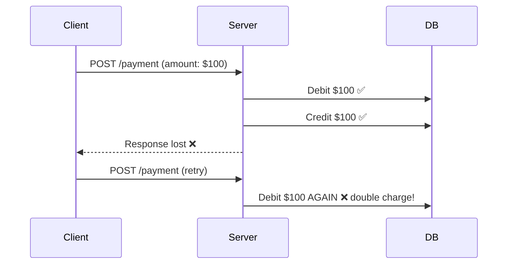
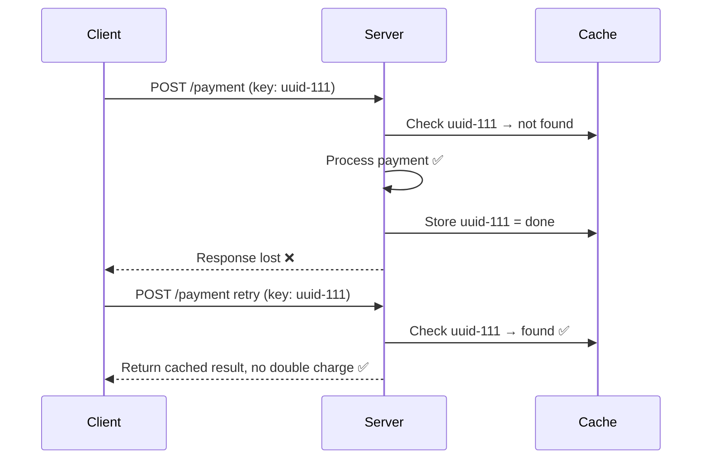

# Idempotency

> **Definition:** Performing the same operation multiple times produces the same result as doing it once.

---

## Table of Contents

- [What is Idempotency?](#what-is-idempotency)
- [HTTP Methods & Idempotency](#http-methods--idempotency)
- [Why it Matters in Distributed Systems](#why-it-matters-in-distributed-systems)
- [Idempotency vs DB Transactions](#idempotency-vs-db-transactions)
- [The Idempotency Key Pattern](#the-idempotency-key-pattern)
- [How to Know if it is a Retry or a New Request](#how-to-know-if-it-is-a-retry-or-a-new-request)
- [Implementation in .NET / C#](#implementation-in-net--c)
- [Frontend Implementation — Angular](#frontend-implementation--angular)
- [Key Takeaways](#key-takeaways)

---

## What is Idempotency?

An operation is idempotent when calling it once or calling it 100 times produces the **exact same end state**.

```
Idempotent:
DELETE /users/123 → user deleted ✅
DELETE /users/123 → user already gone, same end state ✅

NOT Idempotent:
POST /orders → order created (1 order) ✅
POST /orders → order created again (2 orders) ❌
```

---

## HTTP Methods & Idempotency

| Method | Idempotent? | Why |
|---|---|---|
| **GET** | ✅ Yes | Just reads — no side effects |
| **PUT** | ✅ Yes | Sets a value to exactly this — same result every time |
| **DELETE** | ✅ Yes | Deleting twice = same end state |
| **POST** | ❌ No | Creates a new resource each time |
| **PATCH** | ❌ Usually no | Partial update — depends on implementation |

### Why is PUT idempotent?

PUT doesn't say "change this value" — it says **"set this value to exactly this"**.

```
PUT /users/123  { name: "Reyad" }  → name = "Reyad" ✅
PUT /users/123  { name: "Reyad" }  → name = "Reyad" ✅  (same result)
PUT /users/123  { name: "Reyad" }  → name = "Reyad" ✅  (same result)
```

Compare to a non-idempotent update:

```
PATCH /users/123  { balance: +10 }  → balance = 110
PATCH /users/123  { balance: +10 }  → balance = 120  ❌ different result
```

> 💡 **PUT = set to this exact value. PATCH = apply this change.** That's the difference.

### Why is DELETE idempotent?

Idempotency is about the **end state**, not what happens on each call.

```
DELETE /users/123 → user deleted, end state: user does not exist ✅
DELETE /users/123 → user already gone, end state: user does not exist ✅
```

The second call may return 404 — but the end state is identical.

---

## Why it Matters in Distributed Systems

Network failures happen — a client sends a request, doesn't get a response, and retries. If the operation is not idempotent, that retry causes duplicate actions:



With idempotency:



---

## Idempotency vs DB Transactions

A common confusion — they solve **different problems**:

| | DB Transaction | Idempotency |
|---|---|---|
| **Protects against** | Partial failure during processing | Duplicate requests from retries |
| **When it acts** | During the operation | Before the operation starts |
| **The problem** | Operation failed halfway | Operation succeeded but client didn't know |
| **The solution** | Rollback | Detect duplicate, return cached result |

**DB Transaction scenario:**

```
Transaction starts
  → Debit $100 from Account A ✅
  → Credit $100 to Account B ❌ (fails)
Transaction rolls back → Account A refunded ✅
```

**Idempotency scenario:**

```
Transaction succeeds completely ✅
Response lost in network ❌
Client retries → without idempotency → double charge ❌
Client retries → with idempotency key → deduplicated ✅
```

> 💡 You need **both** — the transaction ensures atomicity inside the server. The idempotency key ensures the client can safely retry without causing duplicates.

---

## The Idempotency Key Pattern

The general pattern:

```
1. Client generates a unique key (UUID) for each new user action
2. Client sends the key with every request
3. Server checks if this key was already processed
4. If yes → return cached result, skip processing
5. If no  → process, store result against the key, return result
```

---

## How to Know if it is a Retry or a New Request

The client decides — not the server.

> **Same user action = same key. New user action = new key.**

The key is generated **once per user action** and held onto:

```
User clicks "Pay $100"
  → Client generates key: "uuid-111"  ← generated ONCE on click
  → Sends request with "uuid-111"
  → Network drops response
  → Client retries with SAME "uuid-111"  ← same click, same key
  → Server deduplicates ✅

User clicks "Pay $100" again (new intentional action)
  → Client generates NEW key: "uuid-222"  ← new click = new key
  → Sends request with "uuid-222"
  → Server processes as new payment ✅
```

The trick is **when you clear the key**:

```
Success  → clear key → next action generates a fresh key
Failure  → keep key  → retry reuses same key
```

---

## Implementation in .NET / C#

### Controller — checking the idempotency key

```csharp
[HttpPost("payment")]
public async Task<IActionResult> CreatePayment(
    [FromHeader(Name = "X-Idempotency-Key")] string idempotencyKey,
    [FromBody] PaymentRequest request)
{
    // 1. Check if this key was already processed
    var cached = await _cache.GetAsync(idempotencyKey);
    if (cached != null)
    {
        // Return same result without processing again
        return Ok(JsonSerializer.Deserialize<PaymentResponse>(cached));
    }

    // 2. Process the payment
    var result = await _paymentService.ProcessAsync(request);

    // 3. Store result against the key with TTL
    await _cache.SetAsync(
        idempotencyKey,
        JsonSerializer.Serialize(result),
        TimeSpan.FromHours(24)
    );

    return Ok(result);
}
```

### Where to store the idempotency key

| Storage | Pros | Cons |
|---|---|---|
| **Redis** | Fast, TTL built-in, distributed | Extra infrastructure |
| **Database table** | Persistent, reliable | Slower, more storage |
| **In-memory** | Fastest | Lost on restart, not distributed |

> ⚠️ In a horizontally scaled system, **in-memory won't work** — Server 1 stores the key but Server 2 has no idea. Use Redis or DB so all servers share the same store.

### Database approach

```sql
CREATE TABLE idempotency_keys (
    key         VARCHAR(100) PRIMARY KEY,
    response    TEXT,
    created_at  DATETIME,
    expires_at  DATETIME
)
```

```csharp
var existing = await _db.IdempotencyKeys
    .FirstOrDefaultAsync(x => x.Key == idempotencyKey);

if (existing != null)
    return Ok(JsonSerializer.Deserialize<PaymentResponse>(existing.Response));

var result = await _paymentService.ProcessAsync(request);

_db.IdempotencyKeys.Add(new IdempotencyKey {
    Key        = idempotencyKey,
    Response   = JsonSerializer.Serialize(result),
    CreatedAt  = DateTime.UtcNow,
    ExpiresAt  = DateTime.UtcNow.AddHours(24)
});

await _db.SaveChangesAsync();
return Ok(result);
```

### PUT and DELETE — no key needed

```csharp
// PUT — naturally idempotent, just overwrite
public async Task<IActionResult> UpdateUser(int id, UpdateUserRequest request)
{
    var user = await _db.Users.FindAsync(id);
    user.Name = request.Name;  // same result every time
    await _db.SaveChangesAsync();
    return Ok(user);
}

// DELETE — naturally idempotent, check existence
public async Task<IActionResult> DeleteUser(int id)
{
    var user = await _db.Users.FindAsync(id);
    if (user == null) return NotFound();  // already deleted — same end state
    _db.Users.Remove(user);
    await _db.SaveChangesAsync();
    return NoContent();
}
```

---

## Frontend Implementation — Angular

```typescript
export class PaymentComponent {
  private idempotencyKey: string | null = null;

  onPayClick() {
    // Generate key ONCE per user action
    if (!this.idempotencyKey) {
      this.idempotencyKey = crypto.randomUUID();
    }
    this.submitPayment();
  }

  async submitPayment() {
    try {
      await this.paymentService.pay({
        amount: 100,
        idempotencyKey: this.idempotencyKey
      });
      // Success → clear key → next click generates a new one
      this.idempotencyKey = null;
    } catch (error) {
      // Failure → keep key → retry will reuse same key
      console.error('Payment failed, will retry with same key');
    }
  }
}
```

---

## Key Takeaways

- **Idempotency** = same operation, same result — no matter how many times it runs.
- **GET, PUT, DELETE** are naturally idempotent. **POST and PATCH** are not.
- In distributed systems, **network failures cause retries** — without idempotency, retries cause duplicates.
- **Idempotency ≠ DB Transaction** — transactions protect against partial failure during processing. Idempotency protects against duplicate requests from retries.
- The **idempotency key** is generated by the client — once per user action, reused on retries, cleared on success.
- Store idempotency keys in **Redis or DB** — never in-memory in a horizontally scaled system.
- The client controls whether a request is a retry (same key) or a new action (new key).
